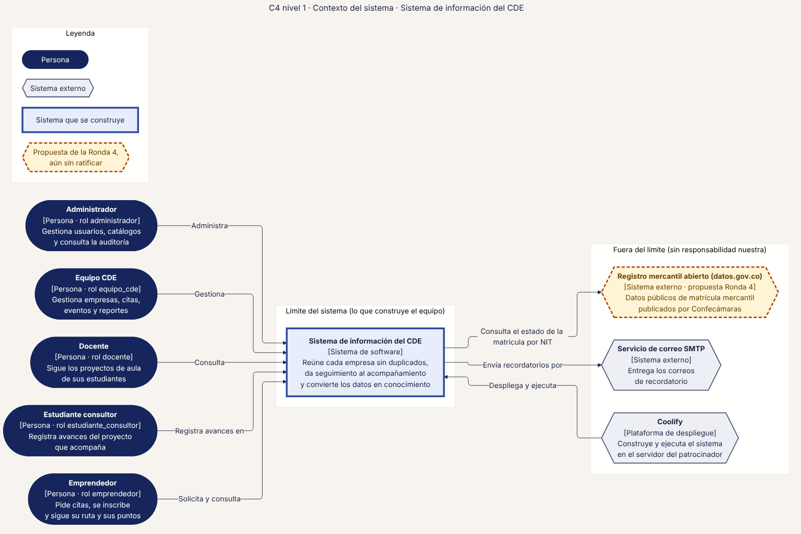
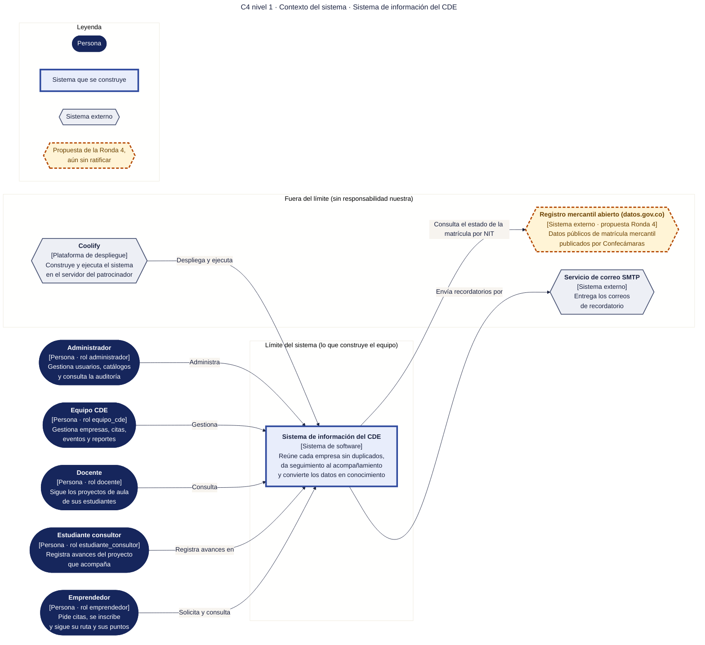

# 10 · C4 nivel 1 · Contexto del sistema

**Qué responde este diagrama.** ¿Quién usa el sistema, con qué sistemas externos habla y qué queda dentro y fuera de lo que construye el equipo?

**A quién sirve.** Todos: jurados, CDE y equipo (diagrama sin tecnologías).

Descargas: [SVG](img/10_c4_contexto.svg) · [PNG](img/10_c4_contexto.png) · [fuente Mermaid](src/10_c4_contexto.mmd)

## Leyenda de notación

Óvalo oscuro = persona · rectángulo azul grueso = sistema o módulo · rectángulo blanco = contenedor · rectángulo gris-azulado = componente · cilindro = almacén de datos · hexágono gris = sistema externo · borde y línea discontinuos naranja = propuesta de la Ronda 4 sin ratificar · borde punteado = decidido en R3 con alcance recortado. Cada flecha se lee «verbo [protocolo o tecnología]» y va en un solo sentido.

## Cómo leerlo y decisiones

1. Las cinco personas son los cinco roles de `04` §2.1.
2. El registro mercantil es una propuesta de la Ronda 4 (RF-32).
3. Coolify se dibuja porque la misión pide el servidor o hosting; GitHub aparece en el diagrama 30.

## Fuentes en el manual

- `01_trazabilidad.md` §1
- `03_stack.md` §8
- `04_datos.md` §2.1
- `investigacion/06_requerimientos_funcionales_detallados.md` RF-32

## Preguntas y contradicciones que lo afectan

Ver `99_preguntas_abiertas_diagramas.md`: Q-D8 (nombre del rol administrador), Q-D9 (nombre del entorno de despliegue).

## Resultado de la revisión

Ver la fila 10 de `90_verificacion_calidad.md` (lista de 18 puntos de `00_investigacion_metodologia.md` §6).

Fuente Mermaid (GitHub la dibuja sin instalar nada)

