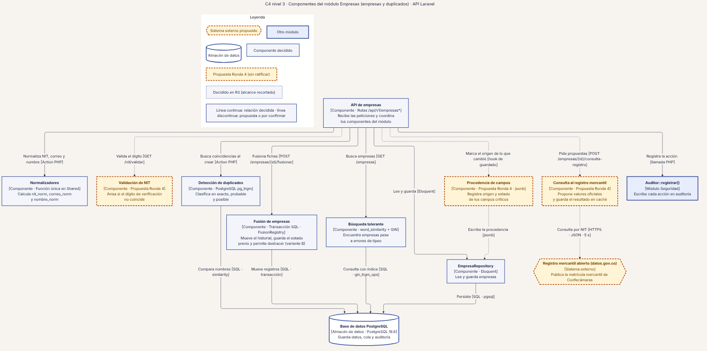
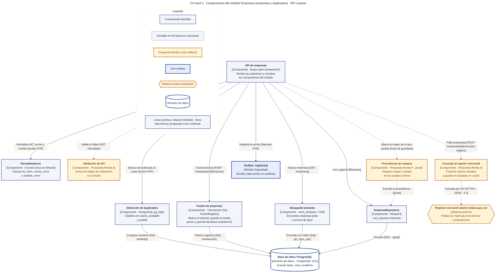

# 13 · C4 nivel 3 · Componentes de Empresas (empresas y duplicados)

**Qué responde este diagrama.** ¿Cómo se normaliza, valida, detecta, fusiona y enriquece una empresa dentro del módulo?

**A quién sirve.** S (núcleo de datos).

Descargas: [SVG](img/13_c4_componentes_empresas.svg) · [PNG](img/13_c4_componentes_empresas.png) · [fuente Mermaid](src/13_c4_componentes_empresas.mmd)

## Leyenda de notación

Óvalo oscuro = persona · rectángulo azul grueso = sistema o módulo · rectángulo blanco = contenedor · rectángulo gris-azulado = componente · cilindro = almacén de datos · hexágono gris = sistema externo · borde y línea discontinuos naranja = propuesta de la Ronda 4 sin ratificar · borde punteado = decidido en R3 con alcance recortado. Cada flecha se lee «verbo [protocolo o tecnología]» y va en un solo sentido.

## Cómo leerlo y decisiones

1. «Completitud de la ficha» se omite para respetar el máximo de 12 elementos; está en `T-11` §5.
2. Los eventos `EmpresaCreada` y `EmpresaFusionada` los publica el módulo (diagrama 12).
3. La validación de NIT, la procedencia y la consulta al registro son propuestas de la Ronda 4.

## Fuentes en el manual

- `01_trazabilidad.md` §3
- `04_datos.md` §4
- `tareas/T-11.md`, `T-12.md`, `T-13.md`
- `investigacion/06_requerimientos_funcionales_detallados.md` RF-31, RF-32, RF-34

## Preguntas y contradicciones que lo afectan

Ver `99_preguntas_abiertas_diagramas.md`: Q-D8.

## Resultado de la revisión

Ver la fila 13 de `90_verificacion_calidad.md` (lista de 18 puntos de `00_investigacion_metodologia.md` §6).

Fuente Mermaid (GitHub la dibuja sin instalar nada)

