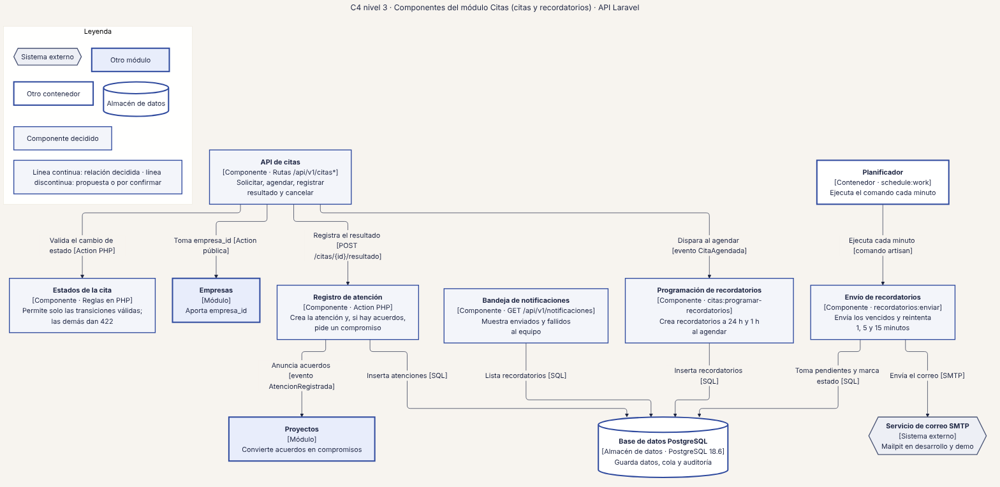
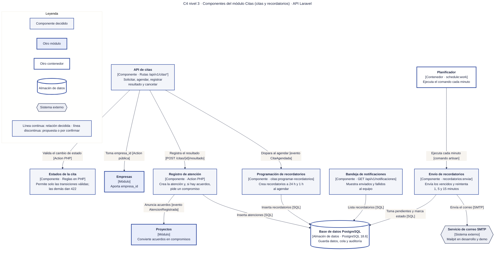

# 14 · C4 nivel 3 · Componentes de Citas (citas y recordatorios)

**Qué responde este diagrama.** ¿Cómo pasa una cita de solicitada a recordada, y quién envía el correo?

**A quién sirve.** J.

Descargas: [SVG](img/14_c4_componentes_citas.svg) · [PNG](img/14_c4_componentes_citas.png) · [fuente Mermaid](src/14_c4_componentes_citas.mmd)

## Leyenda de notación

Óvalo oscuro = persona · rectángulo azul grueso = sistema o módulo · rectángulo blanco = contenedor · rectángulo gris-azulado = componente · cilindro = almacén de datos · hexágono gris = sistema externo · borde y línea discontinuos naranja = propuesta de la Ronda 4 sin ratificar · borde punteado = decidido en R3 con alcance recortado. Cada flecha se lee «verbo [protocolo o tecnología]» y va en un solo sentido.

## Cómo leerlo y decisiones

1. `Programación de recordatorios` reacciona al evento `CitaAgendada`; `Envío de recordatorios` lo dispara el Planificador cada minuto.
2. `Registro de atención` anuncia `AtencionRegistrada` y `Proyectos` crea el compromiso.

## Fuentes en el manual

- `01_trazabilidad.md` §3
- `05_arquitectura.md` §5
- `tareas/T-20.md`, `T-21.md`

## Preguntas y contradicciones que lo afectan

Ver `99_preguntas_abiertas_diagramas.md`: Q-D13.

## Resultado de la revisión

Ver la fila 14 de `90_verificacion_calidad.md` (lista de 18 puntos de `00_investigacion_metodologia.md` §6).

Fuente Mermaid (GitHub la dibuja sin instalar nada)

