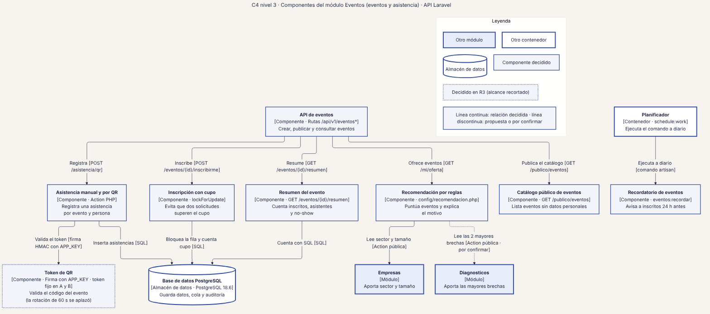
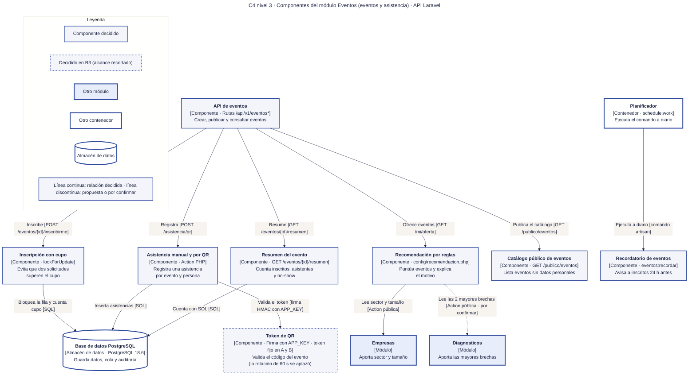

# 15 · C4 nivel 3 · Componentes de Eventos (eventos y asistencia)

**Qué responde este diagrama.** ¿Cómo se inscribe con cupo, se registra la asistencia y se recomienda un evento?

**A quién sirve.** J.

Descargas: [SVG](img/15_c4_componentes_eventos.svg) · [PNG](img/15_c4_componentes_eventos.png) · [fuente Mermaid](src/15_c4_componentes_eventos.mmd)

## Leyenda de notación

Óvalo oscuro = persona · rectángulo azul grueso = sistema o módulo · rectángulo blanco = contenedor · rectángulo gris-azulado = componente · cilindro = almacén de datos · hexágono gris = sistema externo · borde y línea discontinuos naranja = propuesta de la Ronda 4 sin ratificar · borde punteado = decidido en R3 con alcance recortado. Cada flecha se lee «verbo [protocolo o tecnología]» y va en un solo sentido.

## Cómo leerlo y decisiones

1. El token de QR es fijo por evento en A y B; la rotación de 60 s se aplazó (R3).
2. La lectura de brechas por `Recomendación por reglas` es una dependencia por confirmar.

## Fuentes en el manual

- `01_trazabilidad.md` §3
- `tareas/T-23.md` §13
- `tareas/T-25.md`
- `05_arquitectura.md` §7

## Preguntas y contradicciones que lo afectan

Ver `99_preguntas_abiertas_diagramas.md`: Q-D3, Q-D10.

## Resultado de la revisión

Ver la fila 15 de `90_verificacion_calidad.md` (lista de 18 puntos de `00_investigacion_metodologia.md` §6).

Fuente Mermaid (GitHub la dibuja sin instalar nada)

