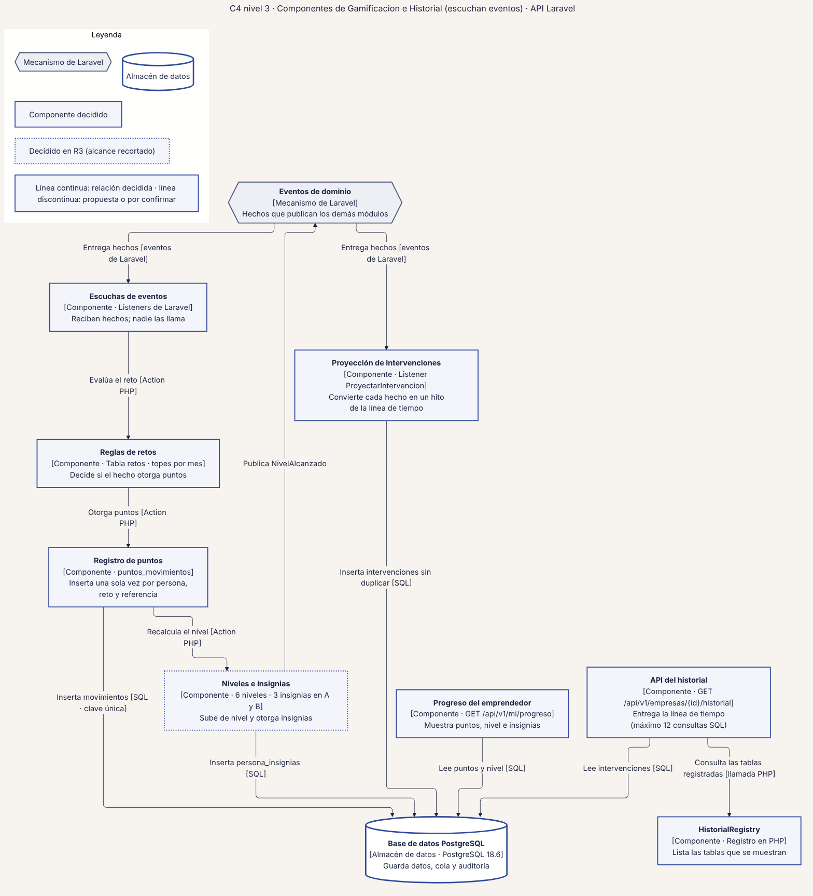
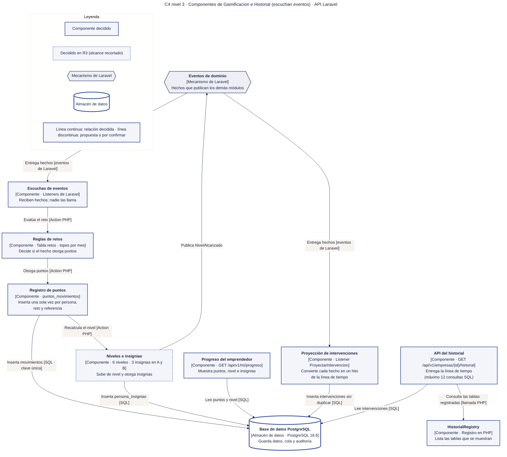

# 17 · C4 nivel 3 · Componentes de Gamificacion e Historial

**Qué responde este diagrama.** ¿Cómo convierten un hecho publicado por otro módulo en puntos y en un hito de la línea de tiempo?

**A quién sirve.** MP y S.

Descargas: [SVG](img/17_c4_componentes_gamificacion_historial.svg) · [PNG](img/17_c4_componentes_gamificacion_historial.png) · [fuente Mermaid](src/17_c4_componentes_gamificacion_historial.mmd)

## Leyenda de notación

Óvalo oscuro = persona · rectángulo azul grueso = sistema o módulo · rectángulo blanco = contenedor · rectángulo gris-azulado = componente · cilindro = almacén de datos · hexágono gris = sistema externo · borde y línea discontinuos naranja = propuesta de la Ronda 4 sin ratificar · borde punteado = decidido en R3 con alcance recortado. Cada flecha se lee «verbo [protocolo o tecnología]» y va en un solo sentido.

## Cómo leerlo y decisiones

1. Las rachas y la cola de validación quedan fuera por R3 (`20` §7).
2. El tope de 12 consultas SQL del historial es criterio de `T-15`.

## Fuentes en el manual

- `01_trazabilidad.md` §3
- `05_arquitectura.md` §2
- `tareas/T-15.md`, `T-43.md`

## Preguntas y contradicciones que lo afectan

Ver `99_preguntas_abiertas_diagramas.md`: Q-D11.

## Resultado de la revisión

Ver la fila 17 de `90_verificacion_calidad.md` (lista de 18 puntos de `00_investigacion_metodologia.md` §6).

Fuente Mermaid (GitHub la dibuja sin instalar nada)

