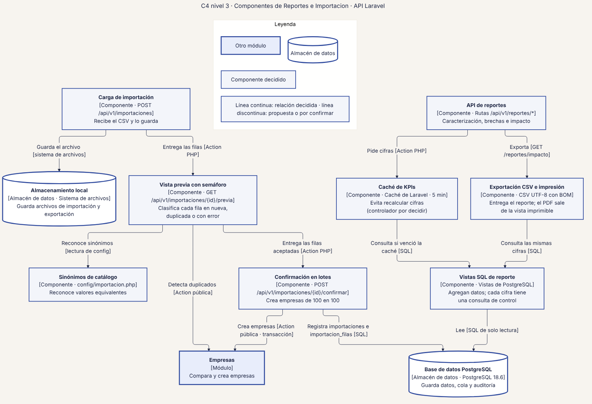
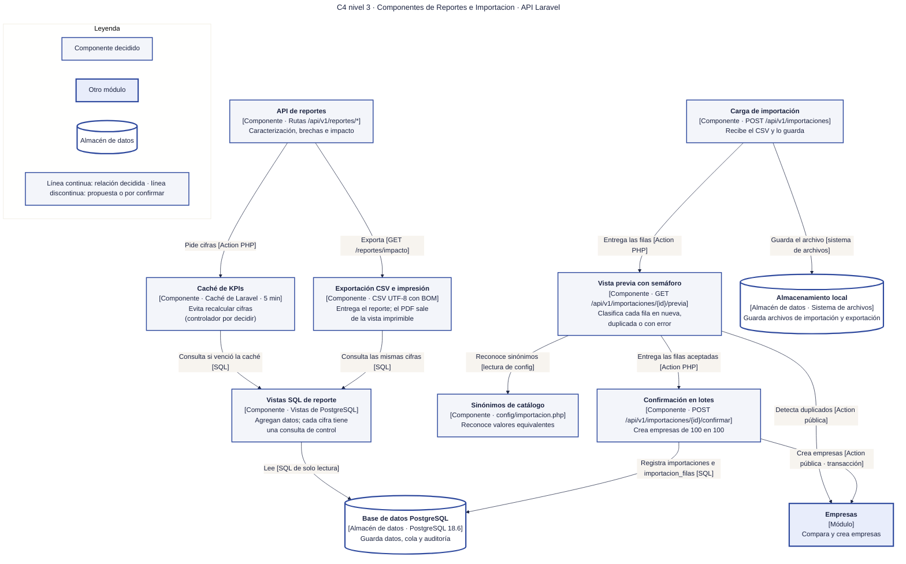

# 18 · C4 nivel 3 · Componentes de Reportes e Importacion

**Qué responde este diagrama.** ¿De dónde salen las cifras del reporte y cómo entra un CSV a la base sin duplicar?

**A quién sirve.** S.

Descargas: [SVG](img/18_c4_componentes_reportes_importacion.svg) · [PNG](img/18_c4_componentes_reportes_importacion.png) · [fuente Mermaid](src/18_c4_componentes_reportes_importacion.mmd)

## Leyenda de notación

Óvalo oscuro = persona · rectángulo azul grueso = sistema o módulo · rectángulo blanco = contenedor · rectángulo gris-azulado = componente · cilindro = almacén de datos · hexágono gris = sistema externo · borde y línea discontinuos naranja = propuesta de la Ronda 4 sin ratificar · borde punteado = decidido en R3 con alcance recortado. Cada flecha se lee «verbo [protocolo o tecnología]» y va en un solo sentido.

## Cómo leerlo y decisiones

1. El controlador de la caché de 5 min no está decidido (Q-D2).
2. `Importacion` usa a `Empresas` solo por su contrato; no hay reversión de la importación completa (decisión R2).

## Fuentes en el manual

- `01_trazabilidad.md` §3
- `05_arquitectura.md` §6
- `tareas/T-14.md`, `T-16.md`

## Preguntas y contradicciones que lo afectan

Ver `99_preguntas_abiertas_diagramas.md`: Q-D2.

## Resultado de la revisión

Ver la fila 18 de `90_verificacion_calidad.md` (lista de 18 puntos de `00_investigacion_metodologia.md` §6).

Fuente Mermaid (GitHub la dibuja sin instalar nada)

