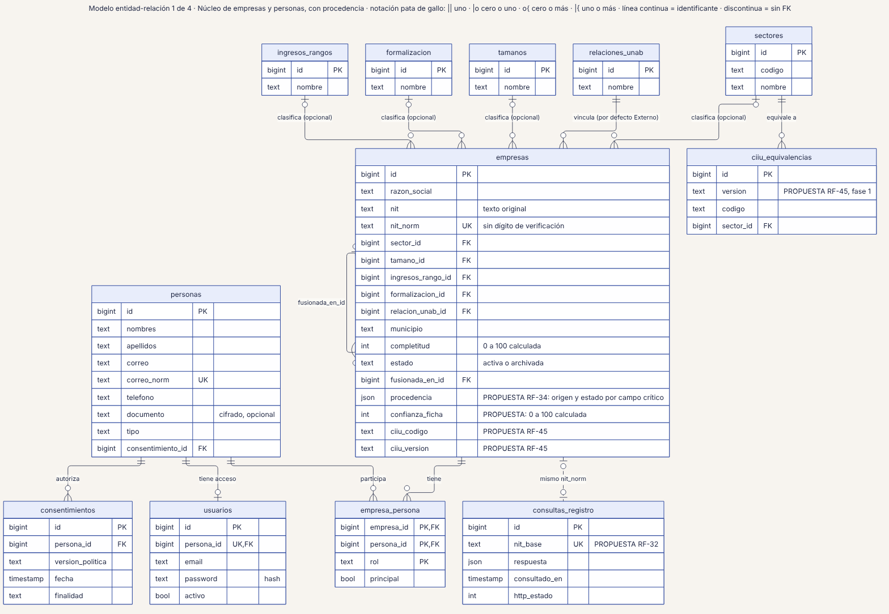
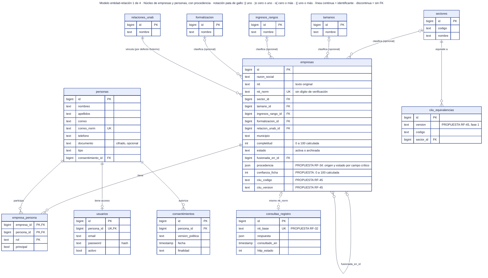

# 20 · Modelo entidad-relación 1 de 4 · Núcleo de empresas y personas

**Qué responde este diagrama.** ¿Cómo se relacionan empresas, personas, usuarios y catálogos, y dónde viven la procedencia y la confianza?

**A quién sirve.** S y J.

Descargas: [SVG](img/20_er_nucleo.svg) · [PNG](img/20_er_nucleo.png) · [fuente Mermaid](src/20_er_nucleo.mmd)

## Leyenda de notación

Cada caja es una tabla con tipos lógicos (los tipos físicos no están decididos en `04`). PK = clave primaria · FK = clave foránea · UK = clave única. Pata de gallo: `||` exactamente uno · `|o` cero o uno · `o{` cero o más · `|{` uno o más. Línea continua = relación con clave foránea; línea discontinua = vínculo sin clave foránea. Los comentarios que empiezan por PROPUESTA son campos de la Ronda 4 sin ratificar.

## Cómo leerlo y decisiones

1. `empresas.procedencia` y `empresas.confianza_ficha` son propuestas de la Ronda 4 (RF-34, §2 de `inv/06`).
2. `consultas_registro` se enlaza por `nit_base`, no por clave foránea.
3. Los roles de `spatie/laravel-permission` no se dibujan (tablas del paquete).

## Fuentes en el manual

- `01_trazabilidad.md` §4
- `04_datos.md` §2.1 y §2.8
- `investigacion/06_requerimientos_funcionales_detallados.md` §2, RF-32, RF-34, RF-45

## Preguntas y contradicciones que lo afectan

Ver `99_preguntas_abiertas_diagramas.md`: Q-D18.

## Resultado de la revisión

Ver la fila 20 de `90_verificacion_calidad.md` (lista de 18 puntos de `00_investigacion_metodologia.md` §6).

Fuente Mermaid (GitHub la dibuja sin instalar nada)

