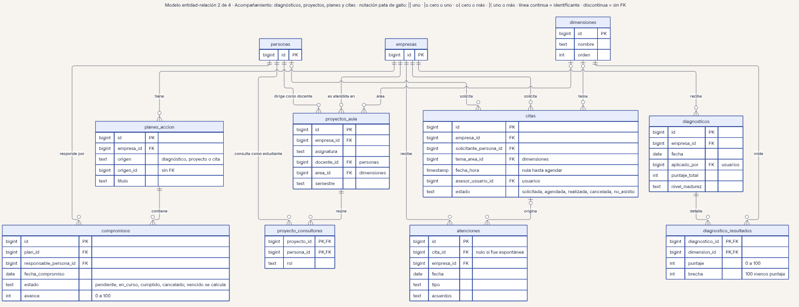

# 21 · Modelo entidad-relación 2 de 4 · Diagnósticos, proyectos, planes y citas

**Qué responde este diagrama.** ¿Qué tablas guardan el acompañamiento a una empresa y cómo se enlazan?

**A quién sirve.** S, J y MP.

Descargas: [SVG](img/21_er_acompanamiento.svg) · [PNG](img/21_er_acompanamiento.png) · [fuente Mermaid](src/21_er_acompanamiento.mmd)

## Leyenda de notación

Cada caja es una tabla con tipos lógicos (los tipos físicos no están decididos en `04`). PK = clave primaria · FK = clave foránea · UK = clave única. Pata de gallo: `||` exactamente uno · `|o` cero o uno · `o{` cero o más · `|{` uno o más. Línea continua = relación con clave foránea; línea discontinua = vínculo sin clave foránea. Los comentarios que empiezan por PROPUESTA son campos de la Ronda 4 sin ratificar.

## Cómo leerlo y decisiones

1. Se omiten las claves hacia `usuarios` y `estados_proyecto` salvo como atributo.
2. `planes_accion.origen_id` no tiene clave foránea (origen polimórfico, `04` §2.3).

## Fuentes en el manual

- `01_trazabilidad.md` §4
- `04_datos.md` §2.2 a §2.4

## Preguntas y contradicciones que lo afectan

Ver `99_preguntas_abiertas_diagramas.md`: Q-D18.

## Resultado de la revisión

Ver la fila 21 de `90_verificacion_calidad.md` (lista de 18 puntos de `00_investigacion_metodologia.md` §6).

```mermaid
---
title: "Modelo entidad-relación 2 de 4 · Acompañamiento: diagnósticos, proyectos, planes y citas · notación pata de gallo: || uno · |o cero o uno · o{ cero o más · |{ uno o más · línea continua = identificante · discontinua = sin FK"
config:
  theme: base
  look: classic
  fontFamily: "Inter, Carlito, Arial, sans-serif"
  themeVariables:
    fontFamily: "Inter, Carlito, Arial, sans-serif"
    fontSize: "16px"
    lineColor: "#1B2340"
    primaryTextColor: "#1B2340"
    primaryColor: "#E8EDFB"
    primaryBorderColor: "#2F4A9E"
    edgeLabelBackground: "#F7F4EF"
    background: "#F7F4EF"
    attributeBackgroundColorOdd: "#FFFFFF"
    attributeBackgroundColorEven: "#F3F5FA"
    entityBorder: "#2F4A9E"
  er:
    layoutDirection: TB
    entityPadding: 12
    fontSize: 15
---
erDiagram
  empresas ||--o{ diagnosticos : "recibe"
  diagnosticos ||--o{ diagnostico_resultados : "detalla"
  dimensiones ||--o{ diagnostico_resultados : "mide"
  empresas ||--o{ proyectos_aula : "es atendida en"
  personas ||--o{ proyectos_aula : "dirige como docente"
  dimensiones |o--o{ proyectos_aula : "área"
  proyectos_aula ||--o{ proyecto_consultores : "reúne"
  personas ||--o{ proyecto_consultores : "consulta como estudiante"
  empresas ||--o{ planes_accion : "tiene"
  planes_accion ||--o{ compromisos : "contiene"
  personas ||--o{ compromisos : "responde por"
  empresas ||--o{ citas : "solicita"
  personas |o--o{ citas : "solicita"
  dimensiones |o--o{ citas : "tema"
  citas |o--o{ atenciones : "origina"
  empresas ||--o{ atenciones : "recibe"
  empresas {
    bigint id PK
  }
  personas {
    bigint id PK
  }
  dimensiones {
    bigint id PK
    text nombre
    int orden
  }
  diagnosticos {
    bigint id PK
    bigint empresa_id FK
    date fecha
    bigint aplicado_por FK "usuarios"
    int puntaje_total
    text nivel_madurez
  }
  diagnostico_resultados {
    bigint diagnostico_id PK, FK
    bigint dimension_id PK, FK
    int puntaje "0 a 100"
    int brecha "100 menos puntaje"
  }
  proyectos_aula {
    bigint id PK
    bigint empresa_id FK
    text asignatura
    bigint docente_id FK "personas"
    bigint area_id FK "dimensiones"
    text semestre
  }
  proyecto_consultores {
    bigint proyecto_id PK, FK
    bigint persona_id PK, FK
    text rol
  }
  planes_accion {
    bigint id PK
    bigint empresa_id FK
    text origen "diagnóstico, proyecto o cita"
    bigint origen_id "sin FK"
    text titulo
  }
  compromisos {
    bigint id PK
    bigint plan_id FK
    bigint responsable_persona_id FK
    date fecha_compromiso
    text estado "pendiente, en_curso, cumplido, cancelado; vencido se calcula"
    int avance "0 a 100"
  }
  citas {
    bigint id PK
    bigint empresa_id FK
    bigint solicitante_persona_id FK
    bigint tema_area_id FK "dimensiones"
    timestamp fecha_hora "nula hasta agendar"
    bigint asesor_usuario_id FK "usuarios"
    text estado "solicitada, agendada, realizada, cancelada, no_asistio"
  }
  atenciones {
    bigint id PK
    bigint cita_id FK "nulo si fue espontánea"
    bigint empresa_id FK
    date fecha
    text tipo
    text acuerdos
  }
```

Fuente Mermaid (GitHub la dibuja sin instalar nada)

