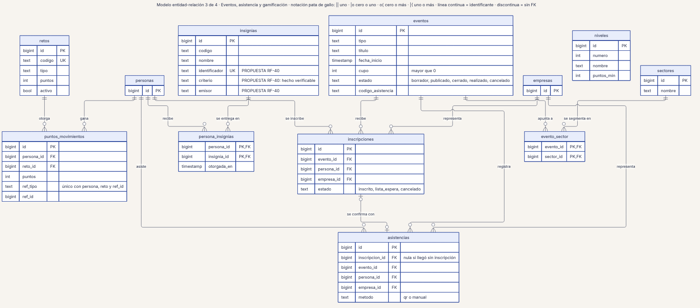
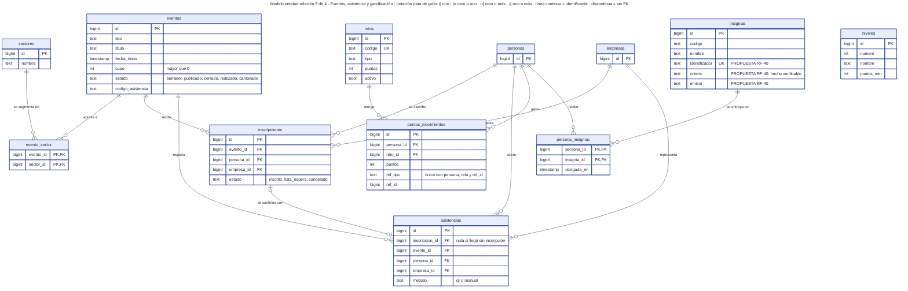

# 22 · Modelo entidad-relación 3 de 4 · Eventos, asistencia y gamificación

**Qué responde este diagrama.** ¿Cómo se relacionan eventos, inscripciones, asistencias, retos, puntos e insignias?

**A quién sirve.** J y MP.

Descargas: [SVG](img/22_er_eventos_gamificacion.svg) · [PNG](img/22_er_eventos_gamificacion.png) · [fuente Mermaid](src/22_er_eventos_gamificacion.mmd)

## Leyenda de notación

Cada caja es una tabla con tipos lógicos (los tipos físicos no están decididos en `04`). PK = clave primaria · FK = clave foránea · UK = clave única. Pata de gallo: `||` exactamente uno · `|o` cero o uno · `o{` cero o más · `|{` uno o más. Línea continua = relación con clave foránea; línea discontinua = vínculo sin clave foránea. Los comentarios que empiezan por PROPUESTA son campos de la Ronda 4 sin ratificar.

## Cómo leerlo y decisiones

1. `rachas` queda fuera por R3; `convocatorias` está diferida.
2. Los campos de `insignias` marcados PROPUESTA son RF-40.

## Fuentes en el manual

- `01_trazabilidad.md` §4
- `04_datos.md` §2.5 y §2.7
- `investigacion/06_requerimientos_funcionales_detallados.md` RF-40

## Preguntas y contradicciones que lo afectan

Ver `99_preguntas_abiertas_diagramas.md`: Q-D18.

## Resultado de la revisión

Ver la fila 22 de `90_verificacion_calidad.md` (lista de 18 puntos de `00_investigacion_metodologia.md` §6).

Fuente Mermaid (GitHub la dibuja sin instalar nada)

