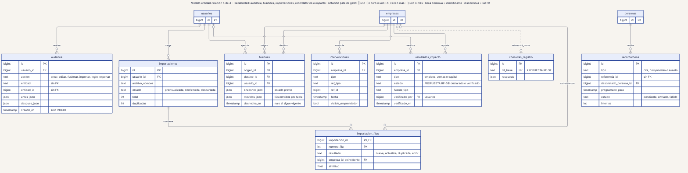

# 23 · Modelo entidad-relación 4 de 4 · Auditoría, fusiones, importaciones, recordatorios e impacto

**Qué responde este diagrama.** ¿Dónde queda el rastro de cada acción y qué guarda cada tabla de trazabilidad?

**A quién sirve.** S.

Descargas: [SVG](img/23_er_sistema_trazabilidad.svg) · [PNG](img/23_er_sistema_trazabilidad.png) · [fuente Mermaid](src/23_er_sistema_trazabilidad.mmd)

## Leyenda de notación

Cada caja es una tabla con tipos lógicos (los tipos físicos no están decididos en `04`). PK = clave primaria · FK = clave foránea · UK = clave única. Pata de gallo: `||` exactamente uno · `|o` cero o uno · `o{` cero o más · `|{` uno o más. Línea continua = relación con clave foránea; línea discontinua = vínculo sin clave foránea. Los comentarios que empiezan por PROPUESTA son campos de la Ronda 4 sin ratificar.

## Cómo leerlo y decisiones

1. `resultados_impacto` y `consultas_registro` son propuestas de la Ronda 4.
2. `auditoria` solo admite INSERT.

## Fuentes en el manual

- `01_trazabilidad.md` §4
- `04_datos.md` §2.4, §2.6 y §2.8
- `tareas/T-12.md` §5
- `investigacion/06_requerimientos_funcionales_detallados.md` RF-32, RF-38

## Preguntas y contradicciones que lo afectan

Ver `99_preguntas_abiertas_diagramas.md`: Q-D5, Q-D18.

## Resultado de la revisión

Ver la fila 23 de `90_verificacion_calidad.md` (lista de 18 puntos de `00_investigacion_metodologia.md` §6).

```mermaid
---
title: "Modelo entidad-relación 4 de 4 · Trazabilidad: auditoría, fusiones, importaciones, recordatorios e impacto · notación pata de gallo: || uno · |o cero o uno · o{ cero o más · |{ uno o más · línea continua = identificante · discontinua = sin FK"
config:
  theme: base
  look: classic
  fontFamily: "Inter, Carlito, Arial, sans-serif"
  themeVariables:
    fontFamily: "Inter, Carlito, Arial, sans-serif"
    fontSize: "16px"
    lineColor: "#1B2340"
    primaryTextColor: "#1B2340"
    primaryColor: "#E8EDFB"
    primaryBorderColor: "#2F4A9E"
    edgeLabelBackground: "#F7F4EF"
    background: "#F7F4EF"
    attributeBackgroundColorOdd: "#FFFFFF"
    attributeBackgroundColorEven: "#F3F5FA"
    entityBorder: "#2F4A9E"
  er:
    layoutDirection: TB
    entityPadding: 12
    fontSize: 15
---
erDiagram
  usuarios ||--o{ auditoria : "realiza"
  usuarios ||--o{ importaciones : "carga"
  importaciones ||--o{ importacion_filas : "contiene"
  empresas |o--o{ importacion_filas : "coincide con"
  empresas ||--o{ fusiones : "origen"
  empresas ||--o{ fusiones : "destino"
  usuarios ||--o{ fusiones : "ejecuta"
  personas ||--o{ recordatorios : "recibe"
  empresas ||--o{ intervenciones : "acumula"
  empresas ||--o{ resultados_impacto : "reporta"
  usuarios |o--o{ resultados_impacto : "verifica"
  empresas |o..o| consultas_registro : "mismo nit_norm"
  empresas {
    bigint id PK
  }
  personas {
    bigint id PK
  }
  usuarios {
    bigint id PK
  }
  auditoria {
    bigint id PK
    bigint usuario_id FK
    text accion "crear, editar, fusionar, importar, login, exportar"
    text entidad "sin FK"
    bigint entidad_id "sin FK"
    json antes_json
    json despues_json
    timestamp creado_en "solo INSERT"
  }
  importaciones {
    bigint id PK
    bigint usuario_id FK
    text archivo_nombre
    text estado "previsualizada, confirmada, descartada"
    int total
    int duplicadas
  }
  importacion_filas {
    bigint importacion_id PK, FK
    int numero_fila PK
    text resultado "nueva, actualiza, duplicada, error"
    bigint empresa_id_coincidente FK
    float similitud
  }
  fusiones {
    bigint id PK
    bigint origen_id FK
    bigint destino_id FK
    bigint usuario_id FK
    json snapshot_json "estado previo"
    json movidos_json "IDs movidos por tabla"
    timestamp deshecha_en "nulo si sigue vigente"
  }
  recordatorios {
    bigint id PK
    text tipo "cita, compromiso o evento"
    bigint referencia_id "sin FK"
    bigint destinatario_persona_id FK
    timestamp programado_para
    text estado "pendiente, enviado, fallido"
    int intentos
  }
  intervenciones {
    bigint id PK
    bigint empresa_id FK
    text tipo
    text ref_tipo
    bigint ref_id
    timestamp fecha
    bool visible_emprendedor
  }
  consultas_registro {
    bigint id PK
    text nit_base UK "PROPUESTA RF-32"
    json respuesta
  }
  resultados_impacto {
    bigint id PK
    bigint empresa_id FK
    text tipo "empleos, ventas o capital"
    text estado "PROPUESTA RF-38: declarado o verificado"
    text fuente_tipo
    bigint verificado_por FK "usuarios"
    timestamp verificado_en
  }
```

Fuente Mermaid (GitHub la dibuja sin instalar nada)

