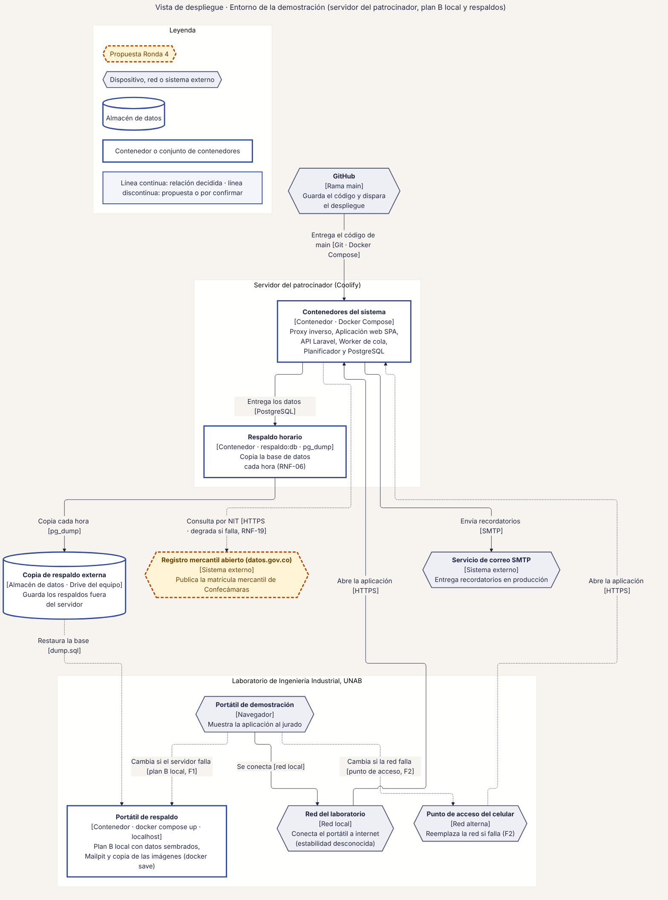
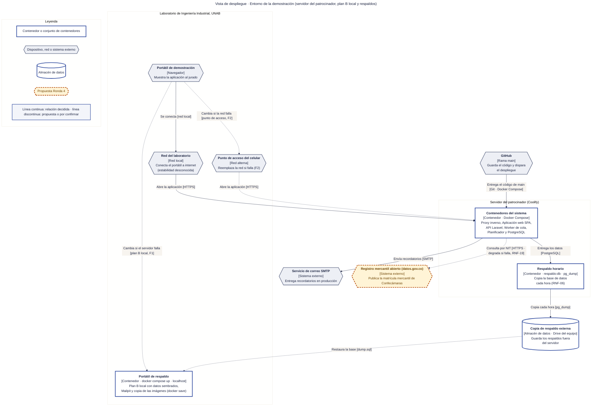

# 30 · Vista de despliegue · Entorno de la demostración

**Qué responde este diagrama.** ¿Dónde corre cada cosa el día de la demo y de qué se cuelga?

**A quién sirve.** J (operación) y jurados técnicos.

Descargas: [SVG](img/30_despliegue.svg) · [PNG](img/30_despliegue.png) · [fuente Mermaid](src/30_despliegue.mmd)

## Leyenda de notación

Rectángulo = contenedor o conjunto de contenedores · hexágono gris = dispositivo, red o sistema externo · cilindro = almacén de datos · recuadros con título = nodos físicos o lógicos · línea continua = relación decidida · línea discontinua = cambio de plan (plan B) o propuesta de la Ronda 4.

## Cómo leerlo y decisiones

1. El manual llama al entorno «servidor del patrocinador con Coolify»; la misión dice «homelab» (Q-D9).
2. Los contenedores se agrupan en un solo bloque para respetar el máximo de 12 elementos; sus nombres están en el diagrama 11.

## Fuentes en el manual

- `01_trazabilidad.md` §7
- `03_stack.md` §8
- `23_contingencias_y_simulacro.md` §3

## Preguntas y contradicciones que lo afectan

Ver `99_preguntas_abiertas_diagramas.md`: Q-D9, Q-D12.

## Resultado de la revisión

Ver la fila 30 de `90_verificacion_calidad.md` (lista de 18 puntos de `00_investigacion_metodologia.md` §6).

Fuente Mermaid (GitHub la dibuja sin instalar nada)

