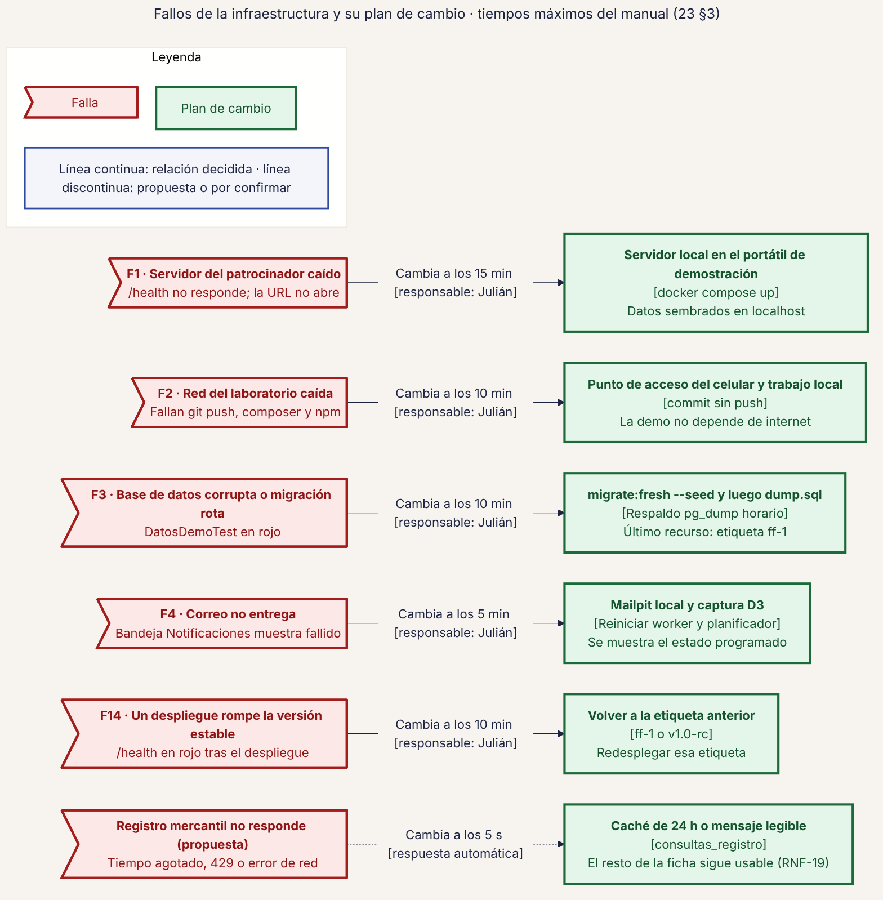
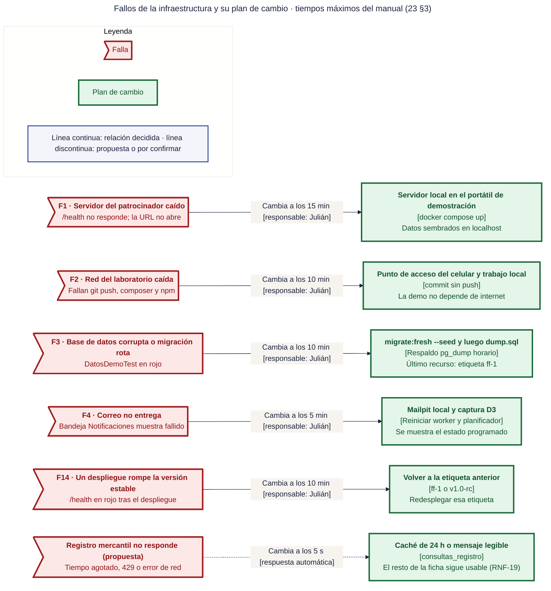

# 31 · Fallos de la infraestructura y su plan de cambio

**Qué responde este diagrama.** ¿Qué falla, cuánto se espera y a qué se cambia?

**A quién sirve.** Todos (ensayo de `23`).

Descargas: [SVG](img/31_fallos_plan_cambio.svg) · [PNG](img/31_fallos_plan_cambio.png) · [fuente Mermaid](src/31_fallos_plan_cambio.mmd)

## Leyenda de notación

Rectángulo = contenedor o conjunto de contenedores · hexágono gris = dispositivo, red o sistema externo · cilindro = almacén de datos · recuadros con título = nodos físicos o lógicos · línea continua = relación decidida · línea discontinua = cambio de plan (plan B) o propuesta de la Ronda 4.

## Cómo leerlo y decisiones

1. Se dibujan solo los fallos de infraestructura (F1, F2, F3, F4, F14); F5 a F13 son de logística y de equipo y están en la tabla de abajo.

## Fuentes en el manual

- `01_trazabilidad.md` §7
- `23_contingencias_y_simulacro.md` §2 y §3

## Preguntas y contradicciones que lo afectan

Ver `99_preguntas_abiertas_diagramas.md`: Q-D14.

## Resultado de la revisión

Ver la fila 31 de `90_verificacion_calidad.md` (lista de 18 puntos de `00_investigacion_metodologia.md` §6).

## Las 15 contingencias de `23` §3 (resumen)

| ID | Fallo | Tiempo máximo | Plan B |
|---|---|---|---|
| F1 | Servidor del patrocinador caído | 15 min (0 s en escena) | Servidor local en el portátil de demostración |
| F2 | Red del laboratorio caída | 10 min | Punto de acceso del celular y trabajo local |
| F3 | Base de datos corrupta o migración rota | 10 min | `migrate:fresh --seed`, luego `dump.sql`, luego `ff-1` |
| F4 | Correo no entrega | 5 min | Mailpit local y captura D3 |
| F5 | Proyector o cable | 3 min | Segundo portátil o deck en PDF impreso |
| F6 | Portátil muerto | 2 min en escena | Portátil de respaldo |
| F7 | Pérdida de rama o repositorio | 10 min | Clon más reciente y `git bundle` |
| F8 | Conflicto de fusión de madrugada | 15 min (0 min durante el sueño) | Abortar y resolver a las 6:00 |
| F9 | CI en rojo sin causa clara | 15 min | `git revert` |
| F10 | Inicio de sesión bloqueado (429) en escena | 0 s | Sesión ya abierta de otro rol |
| F11 | Persona enferma o ausente | inmediato | Reparto alternativo de voces |
| F12 | Un paso de la demo falla en vivo | 0 s | Versión siguiente de la demo |
| F13 | Corte de energía | 5 min | Batería y deck en PDF |
| F14 | Despliegue rompe la versión estable | 10 min | Etiqueta anterior (`ff-1` o `v1.0-rc`) |
| F15 | Certificado o dominio HTTPS inválido | 3 min | Servidor local |

Fuente Mermaid (GitHub la dibuja sin instalar nada)

