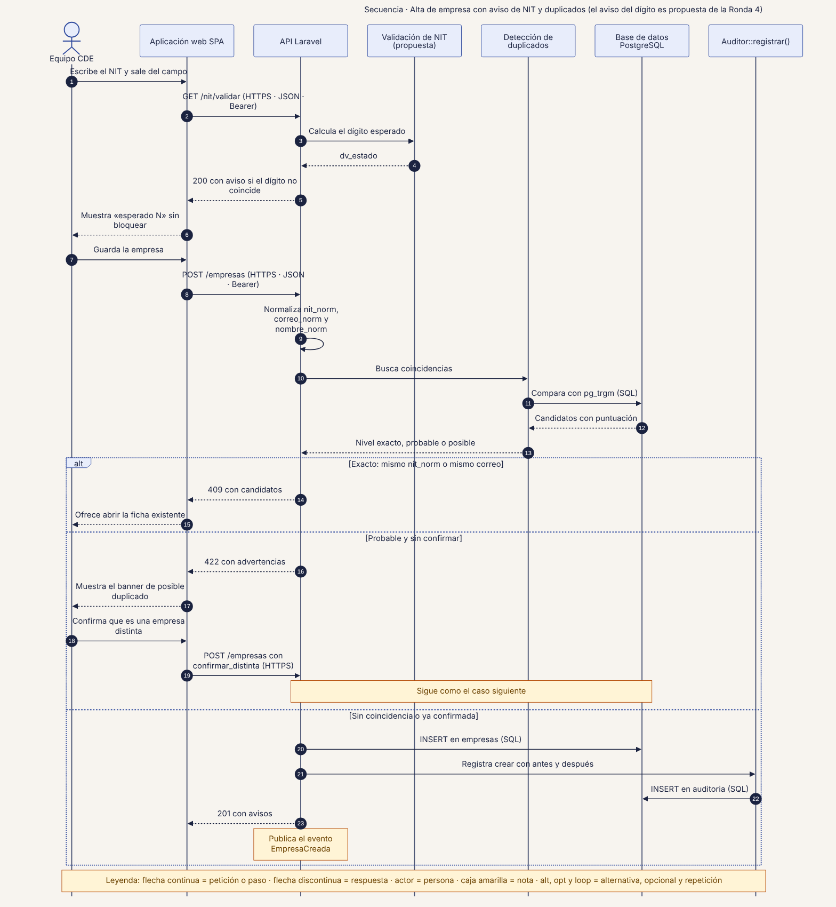
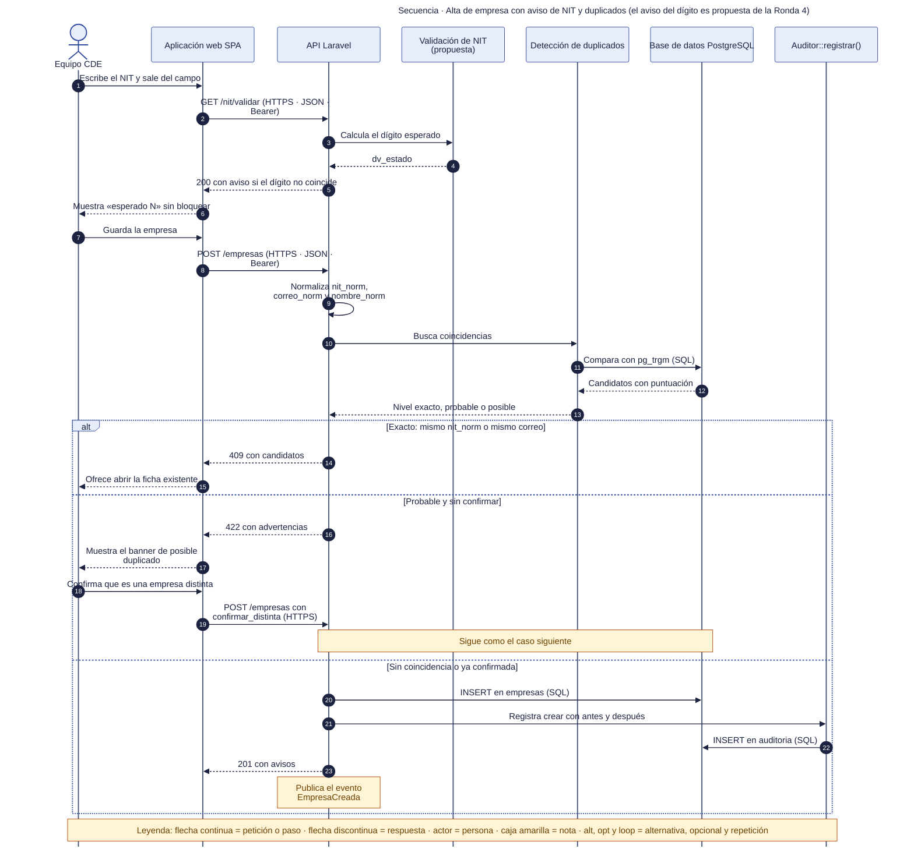

# 40 · Secuencia · Alta de empresa con aviso de NIT y duplicados

**Qué responde este diagrama.** ¿Qué pasa, paso a paso, cuando el equipo crea una empresa?

**A quién sirve.** S y J.

Descargas: [SVG](img/40_secuencia_alta_empresa.svg) · [PNG](img/40_secuencia_alta_empresa.png) · [fuente Mermaid](src/40_secuencia_alta_empresa.mmd)

## Leyenda de notación

Participantes con el nombre del contenedor o componente del diagrama C4. Flecha continua = petición o paso · flecha discontinua = respuesta · actor = persona · caja amarilla = nota · `alt`, `opt` y `loop` = alternativa, opcional y repetición. Los números ordenan los pasos.

## Cómo leerlo y decisiones

1. El aviso del dígito y la ruta `GET /nit/validar` son propuestas de la Ronda 4 (RF-31).
2. `409` solo si el NIT normalizado o el correo coinciden; `422` con advertencias si el nombre es parecido.

## Fuentes en el manual

- `01_trazabilidad.md` §3 y §5
- `tareas/T-11.md`, `T-12.md`
- `investigacion/06_requerimientos_funcionales_detallados.md` RF-31

## Resultado de la revisión

Ver la fila 40 de `90_verificacion_calidad.md` (lista de 18 puntos de `00_investigacion_metodologia.md` §6).

Fuente Mermaid (GitHub la dibuja sin instalar nada)

