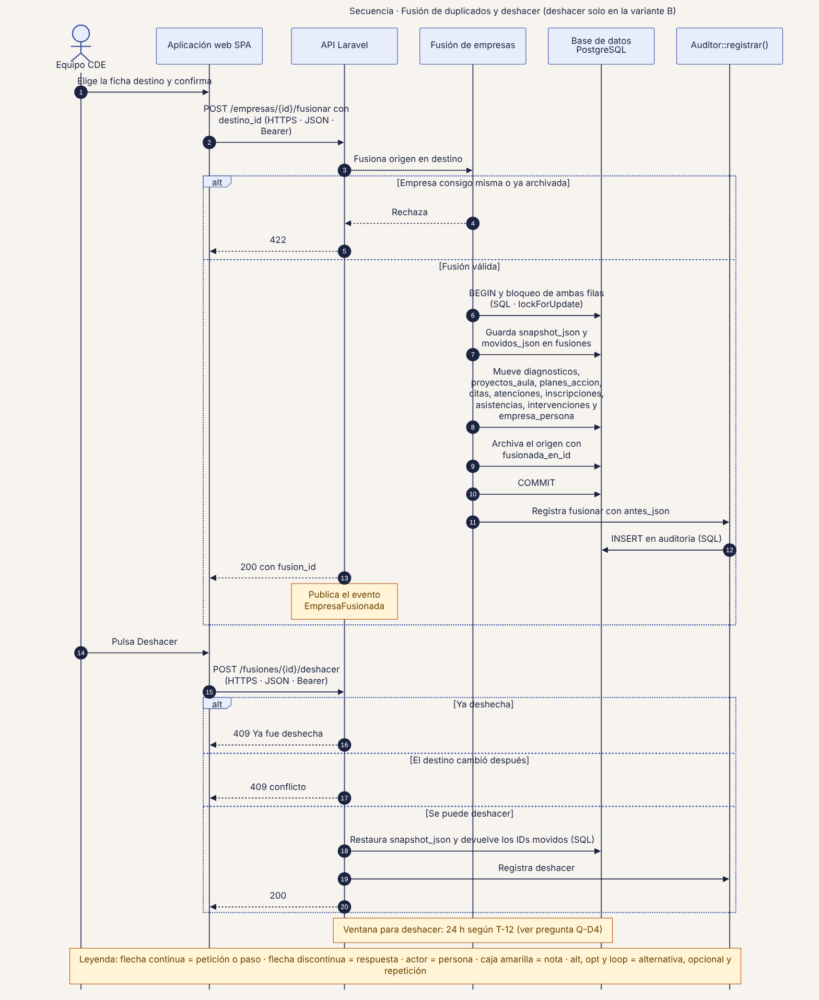
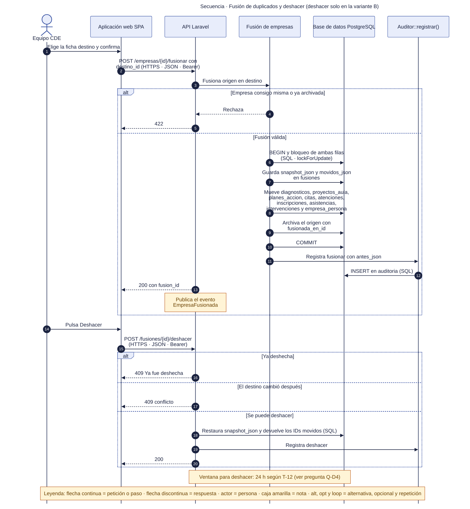

# 41 · Secuencia · Fusión de duplicados y deshacer

**Qué responde este diagrama.** ¿Cómo se fusionan dos fichas sin perder historial y cómo se revierte?

**A quién sirve.** S.

Descargas: [SVG](img/41_secuencia_fusion_deshacer.svg) · [PNG](img/41_secuencia_fusion_deshacer.png) · [fuente Mermaid](src/41_secuencia_fusion_deshacer.mmd)

## Leyenda de notación

Participantes con el nombre del contenedor o componente del diagrama C4. Flecha continua = petición o paso · flecha discontinua = respuesta · actor = persona · caja amarilla = nota · `alt`, `opt` y `loop` = alternativa, opcional y repetición. Los números ordenan los pasos.

## Cómo leerlo y decisiones

1. Deshacer existe solo en la variante B; en A la fusión se confirma y queda en auditoría, sin afirmar reversibilidad (`05` §12).
2. La ventana para deshacer es 24 h en `T-12`, 30 s en el aviso emergente y 30 días en `04` §4 (Q-D4).

## Fuentes en el manual

- `01_trazabilidad.md` §3 y §5
- `tareas/T-12.md` §4 a §6
- `04_datos.md` §4

## Preguntas y contradicciones que lo afectan

Ver `99_preguntas_abiertas_diagramas.md`: Q-D4.

## Resultado de la revisión

Ver la fila 41 de `90_verificacion_calidad.md` (lista de 18 puntos de `00_investigacion_metodologia.md` §6).

Fuente Mermaid (GitHub la dibuja sin instalar nada)

