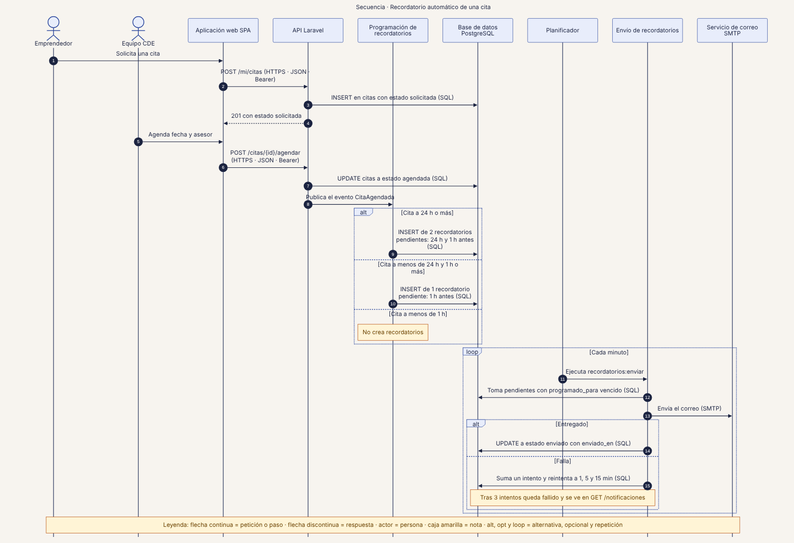
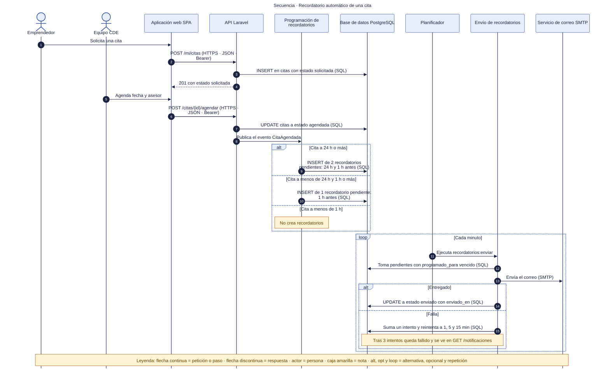

# 43 · Secuencia · Recordatorio automático de una cita

**Qué responde este diagrama.** ¿Cómo se crean, envían y reintentan los recordatorios?

**A quién sirve.** J.

Descargas: [SVG](img/43_secuencia_recordatorio_cita.svg) · [PNG](img/43_secuencia_recordatorio_cita.png) · [fuente Mermaid](src/43_secuencia_recordatorio_cita.mmd)

## Leyenda de notación

Participantes con el nombre del contenedor o componente del diagrama C4. Flecha continua = petición o paso · flecha discontinua = respuesta · actor = persona · caja amarilla = nota · `alt`, `opt` y `loop` = alternativa, opcional y repetición. Los números ordenan los pasos.

## Cómo leerlo y decisiones

1. El envío lo hace el comando `recordatorios:enviar`; si el comando encola en lugar de enviar, el Worker de cola participa (Q-D13).
2. Los recordatorios de una cita cancelada o reprogramada se cancelan y se recrean (Q-D6).

## Fuentes en el manual

- `01_trazabilidad.md` §3 y §6
- `05_arquitectura.md` §5
- `tareas/T-20.md`, `T-21.md`

## Preguntas y contradicciones que lo afectan

Ver `99_preguntas_abiertas_diagramas.md`: Q-D6, Q-D13.

## Resultado de la revisión

Ver la fila 43 de `90_verificacion_calidad.md` (lista de 18 puntos de `00_investigacion_metodologia.md` §6).

Fuente Mermaid (GitHub la dibuja sin instalar nada)

