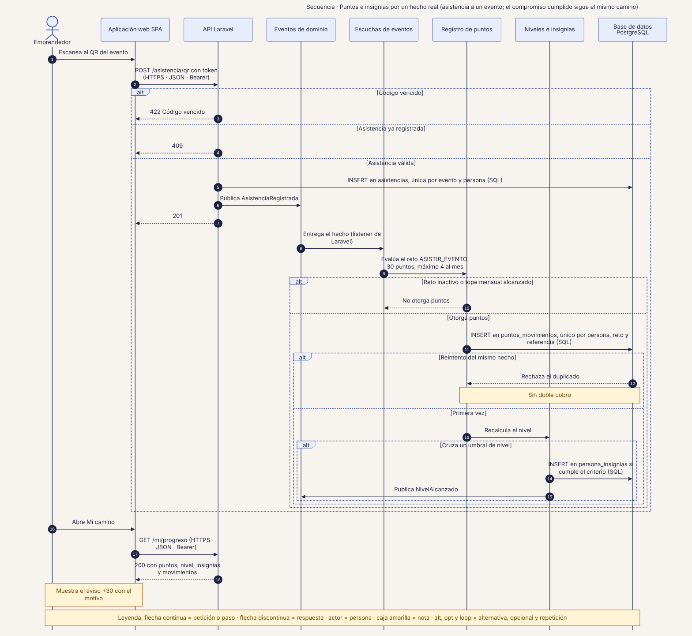
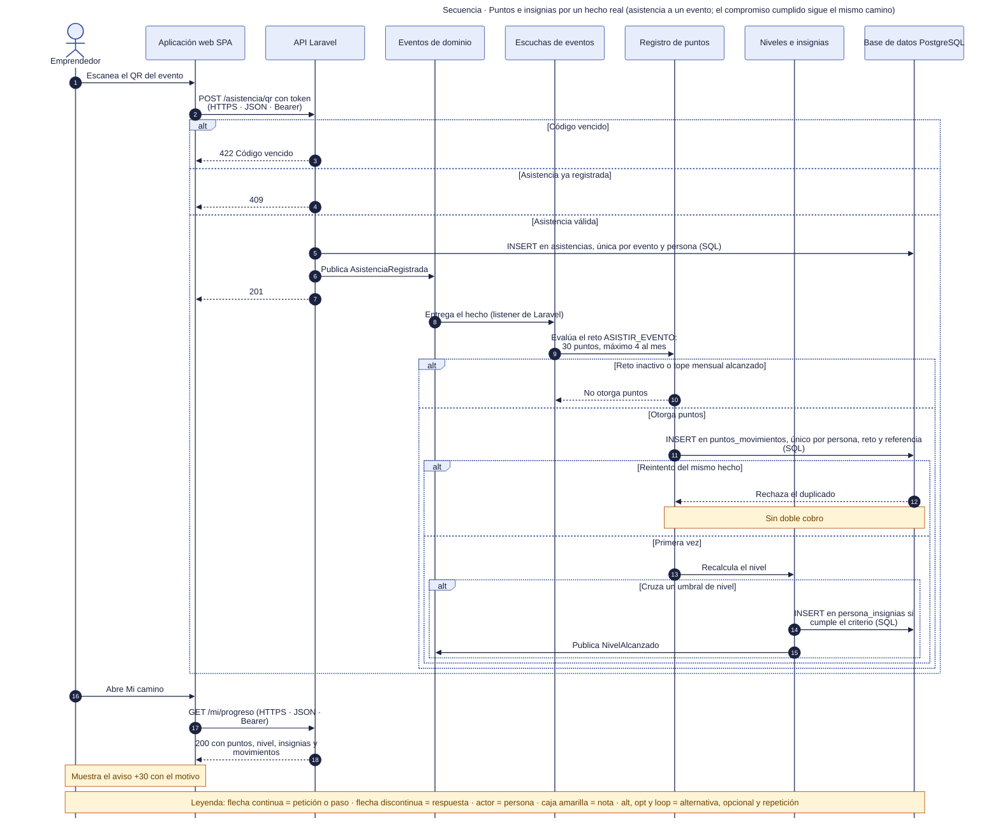

# 44 · Secuencia · Puntos e insignias por un hecho real

**Qué responde este diagrama.** ¿Cómo un hecho verificable del sistema se convierte en puntos sin doble cobro?

**A quién sirve.** MP.

Descargas: [SVG](img/44_secuencia_puntos_insignias.svg) · [PNG](img/44_secuencia_puntos_insignias.png) · [fuente Mermaid](src/44_secuencia_puntos_insignias.mmd)

## Leyenda de notación

Participantes con el nombre del contenedor o componente del diagrama C4. Flecha continua = petición o paso · flecha discontinua = respuesta · actor = persona · caja amarilla = nota · `alt`, `opt` y `loop` = alternativa, opcional y repetición. Los números ordenan los pasos.

## Cómo leerlo y decisiones

1. El QR es fijo por evento en A y B (R3).
2. En A y B el equipo marca el compromiso como cumplido y el hecho `CompromisoCumplido` sigue el mismo camino.

## Fuentes en el manual

- `01_trazabilidad.md` §3, §5 y §6
- `06_ux_gamificacion.md` §7.2
- `tareas/T-23.md`, `T-43.md`

## Preguntas y contradicciones que lo afectan

Ver `99_preguntas_abiertas_diagramas.md`: Q-D10, Q-D11.

## Resultado de la revisión

Ver la fila 44 de `90_verificacion_calidad.md` (lista de 18 puntos de `00_investigacion_metodologia.md` §6).

Fuente Mermaid (GitHub la dibuja sin instalar nada)

