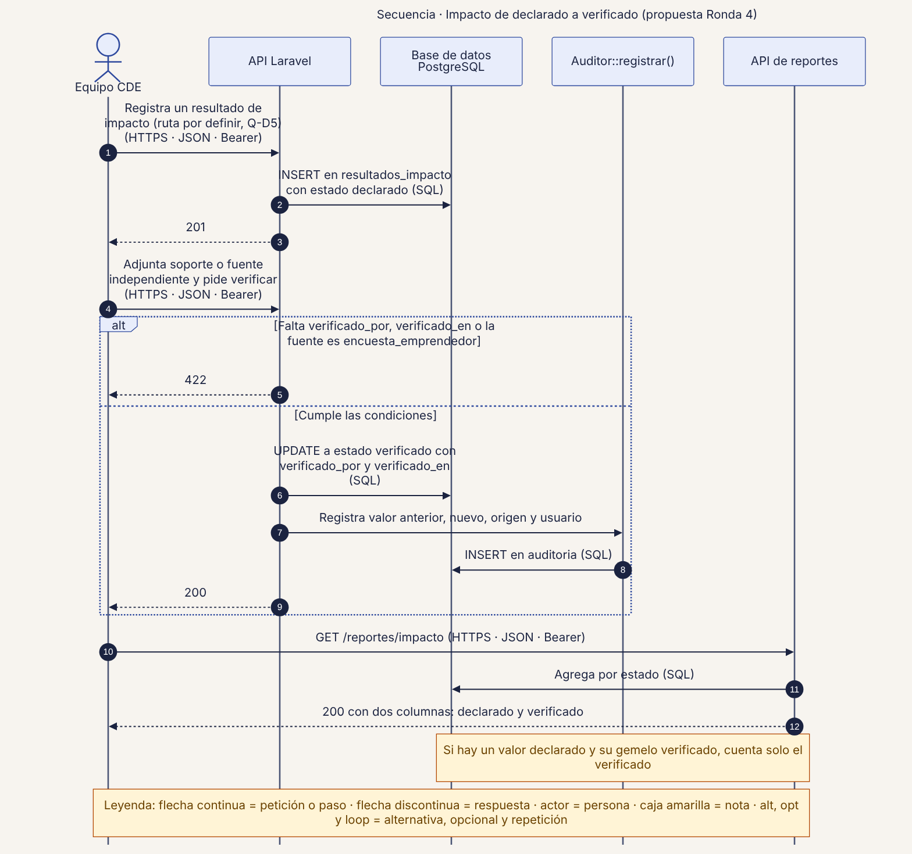
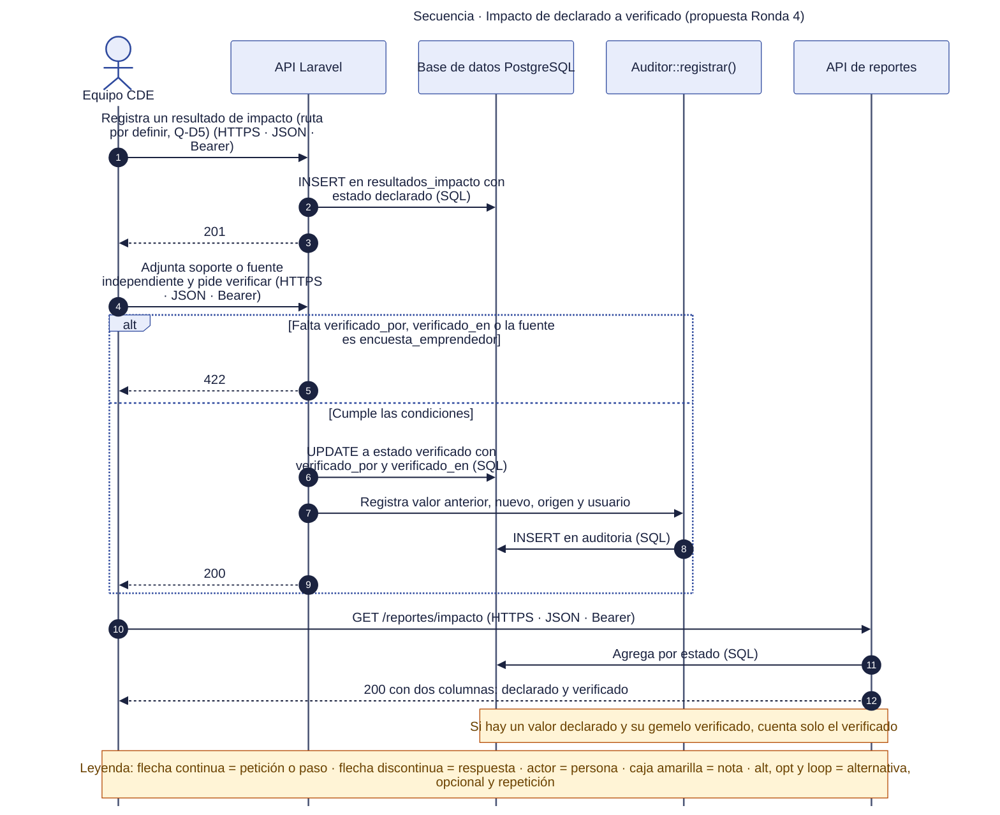

# 45 · Secuencia · Resultado de impacto de declarado a verificado

**Qué responde este diagrama.** ¿Quién y con qué condiciones convierte un resultado declarado en verificado?

**A quién sirve.** S, MP y jurado de negocio.

Descargas: [SVG](img/45_secuencia_verificacion_impacto.svg) · [PNG](img/45_secuencia_verificacion_impacto.png) · [fuente Mermaid](src/45_secuencia_verificacion_impacto.mmd)

## Leyenda de notación

Participantes con el nombre del contenedor o componente del diagrama C4. Flecha continua = petición o paso · flecha discontinua = respuesta · actor = persona · caja amarilla = nota · `alt`, `opt` y `loop` = alternativa, opcional y repetición. Los números ordenan los pasos.

## Cómo leerlo y decisiones

1. Propuesta de la Ronda 4 de fase 2: el manual no define las rutas de `resultados_impacto` (Q-D5).

## Fuentes en el manual

- `01_trazabilidad.md` §4
- `investigacion/06_requerimientos_funcionales_detallados.md` RF-37, RF-38

## Preguntas y contradicciones que lo afectan

Ver `99_preguntas_abiertas_diagramas.md`: Q-D5.

## Resultado de la revisión

Ver la fila 45 de `90_verificacion_calidad.md` (lista de 18 puntos de `00_investigacion_metodologia.md` §6).

Fuente Mermaid (GitHub la dibuja sin instalar nada)

