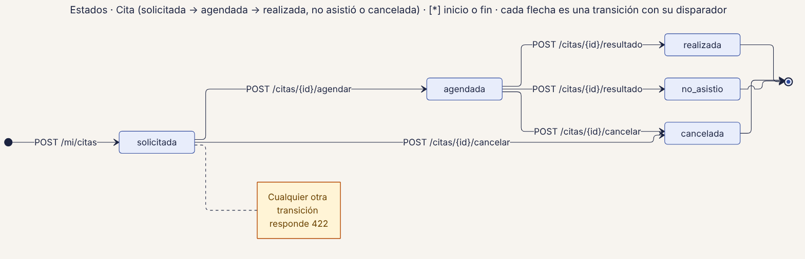
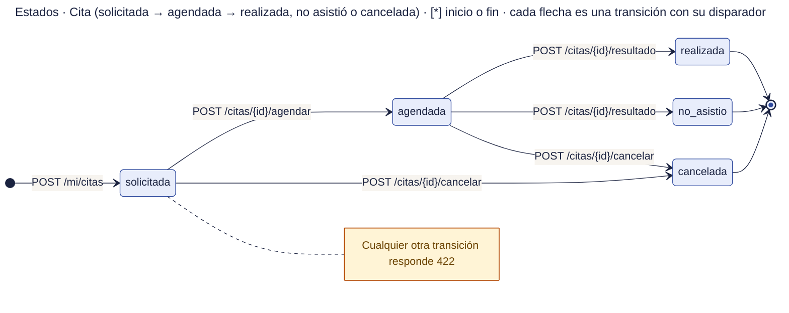

# 50 · Estados · Cita

**Qué responde este diagrama.** ¿Qué estados tiene una cita y qué cambios son válidos?

**A quién sirve.** J.

Descargas: [SVG](img/50_estados_cita.svg) · [PNG](img/50_estados_cita.png) · [fuente Mermaid](src/50_estados_cita.mmd)

## Leyenda de notación

Cada caja es un estado con el nombre exacto del manual · punto negro = inicio · círculo con punto = fin · cada flecha es una transición con su disparador (ruta o regla) · caja amarilla = nota.

## Cómo leerlo y decisiones

1. Cualquier otra transición responde 422.

## Fuentes en el manual

- `01_trazabilidad.md` §6
- `tareas/T-20.md` §5

## Resultado de la revisión

Ver la fila 50 de `90_verificacion_calidad.md` (lista de 18 puntos de `00_investigacion_metodologia.md` §6).

Fuente Mermaid (GitHub la dibuja sin instalar nada)

