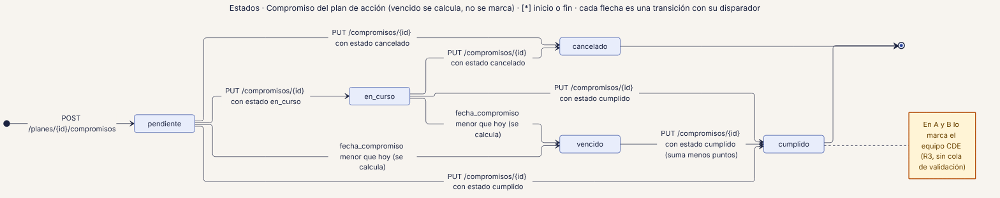
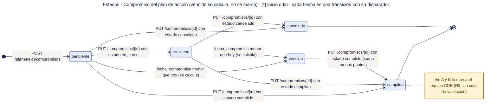

# 51 · Estados · Compromiso del plan de acción

**Qué responde este diagrama.** ¿Cómo avanza un compromiso y por qué `vencido` no se marca a mano?

**A quién sirve.** MP.

Descargas: [SVG](img/51_estados_compromiso.svg) · [PNG](img/51_estados_compromiso.png) · [fuente Mermaid](src/51_estados_compromiso.mmd)

## Leyenda de notación

Cada caja es un estado con el nombre exacto del manual · punto negro = inicio · círculo con punto = fin · cada flecha es una transición con su disparador (ruta o regla) · caja amarilla = nota.

## Cómo leerlo y decisiones

1. En A y B el equipo lo marca como cumplido; no hay cola de validación (R3).

## Fuentes en el manual

- `01_trazabilidad.md` §6
- `tareas/T-42.md` §5
- `tareas/T-43.md` §13

## Preguntas y contradicciones que lo afectan

Ver `99_preguntas_abiertas_diagramas.md`: Q-D11.

## Resultado de la revisión

Ver la fila 51 de `90_verificacion_calidad.md` (lista de 18 puntos de `00_investigacion_metodologia.md` §6).

Fuente Mermaid (GitHub la dibuja sin instalar nada)

