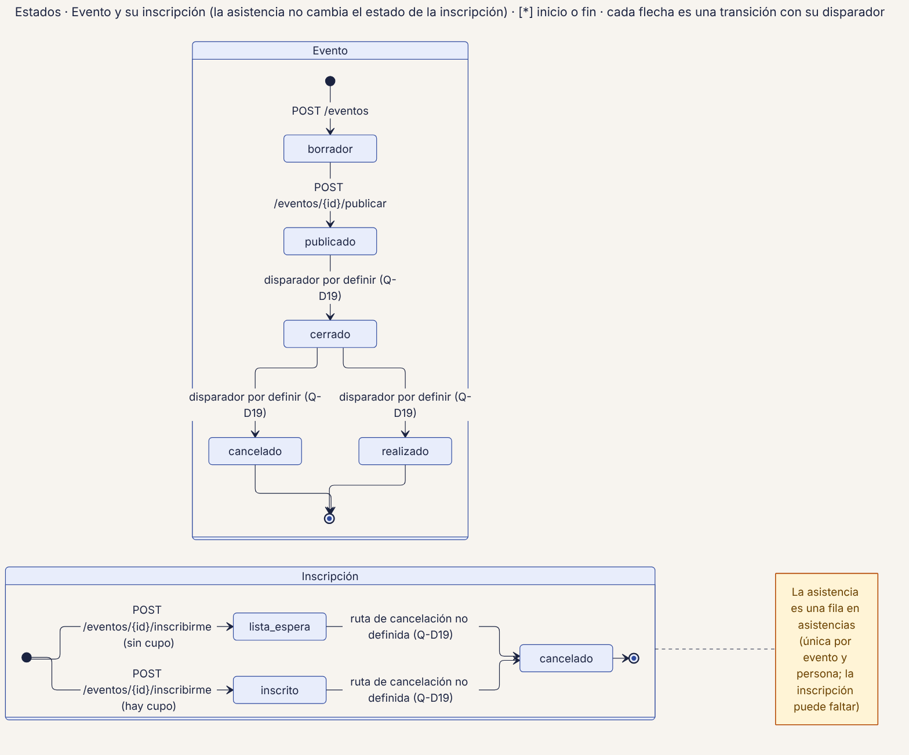
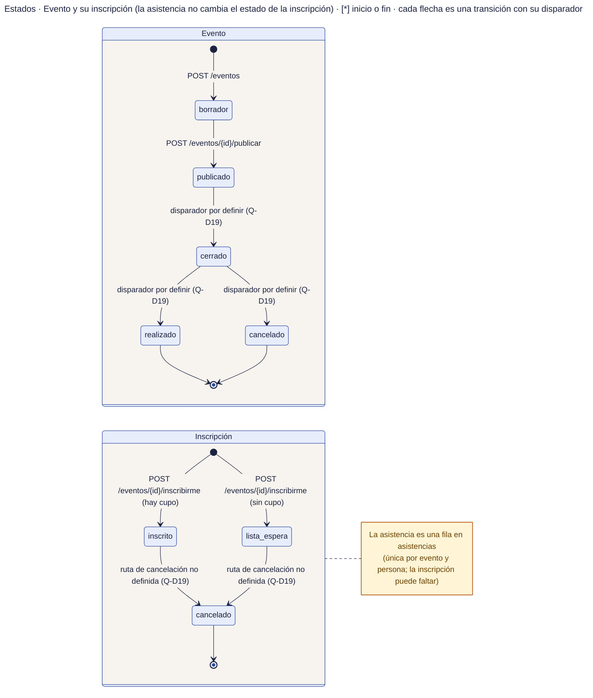

# 52 · Estados · Evento e inscripción

**Qué responde este diagrama.** ¿Cómo pasa un evento a realizado y una inscripción a cancelada, y dónde queda la asistencia?

**A quién sirve.** J.

Descargas: [SVG](img/52_estados_evento_inscripcion.svg) · [PNG](img/52_estados_evento_inscripcion.png) · [fuente Mermaid](src/52_estados_evento_inscripcion.mmd)

## Leyenda de notación

Cada caja es un estado con el nombre exacto del manual · punto negro = inicio · círculo con punto = fin · cada flecha es una transición con su disparador (ruta o regla) · caja amarilla = nota.

## Cómo leerlo y decisiones

1. La asistencia es una fila de `asistencias`, no un estado de la inscripción.
2. La promoción de `lista_espera` a `inscrito` no está definida (Q-D16).

## Fuentes en el manual

- `01_trazabilidad.md` §6
- `04_datos.md` §2.5
- `tareas/T-23.md` §5

## Preguntas y contradicciones que lo afectan

Ver `99_preguntas_abiertas_diagramas.md`: Q-D16.

## Resultado de la revisión

Ver la fila 52 de `90_verificacion_calidad.md` (lista de 18 puntos de `00_investigacion_metodologia.md` §6).

Fuente Mermaid (GitHub la dibuja sin instalar nada)

