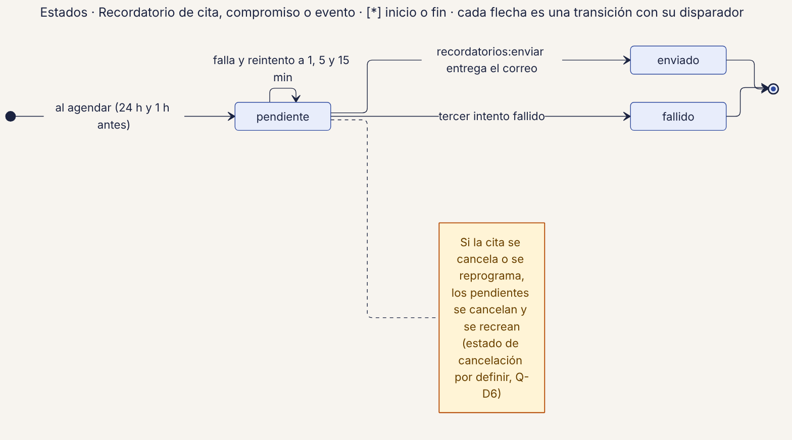
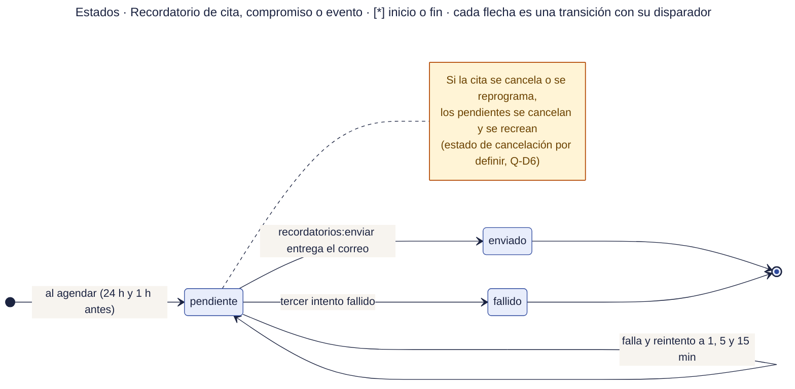

# 53 · Estados · Recordatorio

**Qué responde este diagrama.** ¿Qué estados tiene un recordatorio y cuándo se rinde?

**A quién sirve.** J.

Descargas: [SVG](img/53_estados_recordatorio.svg) · [PNG](img/53_estados_recordatorio.png) · [fuente Mermaid](src/53_estados_recordatorio.mmd)

## Leyenda de notación

Cada caja es un estado con el nombre exacto del manual · punto negro = inicio · círculo con punto = fin · cada flecha es una transición con su disparador (ruta o regla) · caja amarilla = nota.

## Cómo leerlo y decisiones

1. Tras tres intentos queda `fallido` y se ve en la bandeja.

## Fuentes en el manual

- `01_trazabilidad.md` §6
- `tareas/T-21.md` §5

## Preguntas y contradicciones que lo afectan

Ver `99_preguntas_abiertas_diagramas.md`: Q-D6.

## Resultado de la revisión

Ver la fila 53 de `90_verificacion_calidad.md` (lista de 18 puntos de `00_investigacion_metodologia.md` §6).

Fuente Mermaid (GitHub la dibuja sin instalar nada)

