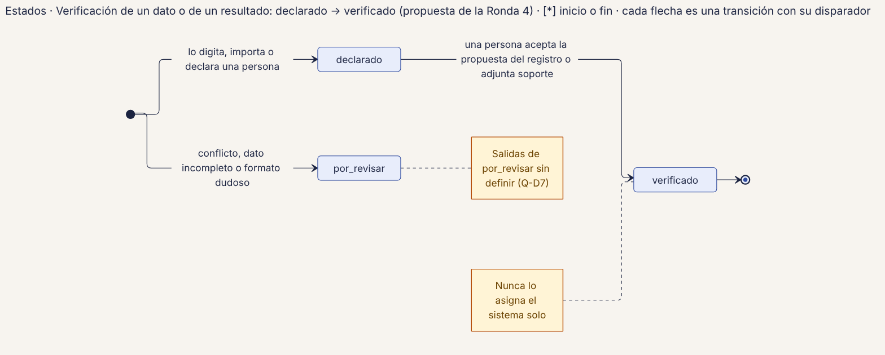
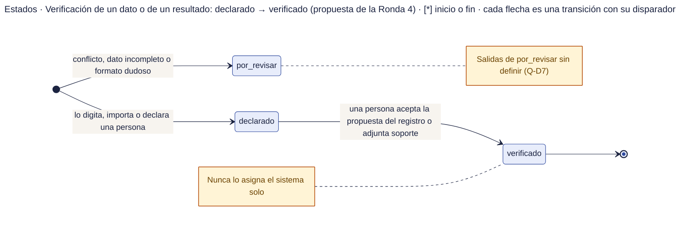

# 54 · Estados · Verificación de un dato o resultado

**Qué responde este diagrama.** ¿Cuándo un dato pasa de declarado a verificado?

**A quién sirve.** S y MP.

Descargas: [SVG](img/54_estados_verificacion.svg) · [PNG](img/54_estados_verificacion.png) · [fuente Mermaid](src/54_estados_verificacion.mmd)

## Leyenda de notación

Cada caja es un estado con el nombre exacto del manual · punto negro = inicio · círculo con punto = fin · cada flecha es una transición con su disparador (ruta o regla) · caja amarilla = nota.

## Cómo leerlo y decisiones

1. Propuesta de la Ronda 4 (RF-34, RF-38).
2. Solo una persona puede verificar; el sistema nunca lo hace solo.

## Fuentes en el manual

- `01_trazabilidad.md` §6
- `investigacion/06_requerimientos_funcionales_detallados.md` §2

## Preguntas y contradicciones que lo afectan

Ver `99_preguntas_abiertas_diagramas.md`: Q-D7.

## Resultado de la revisión

Ver la fila 54 de `90_verificacion_calidad.md` (lista de 18 puntos de `00_investigacion_metodologia.md` §6).

Fuente Mermaid (GitHub la dibuja sin instalar nada)

