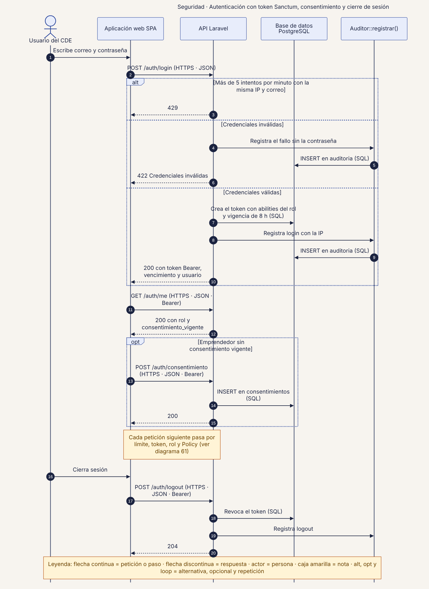
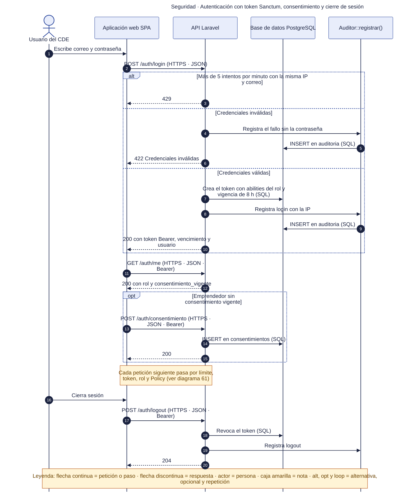

# 60 · Seguridad · Autenticación con token

**Qué responde este diagrama.** ¿Cómo entra un usuario, qué pasa con los intentos fallidos y cómo sale?

**A quién sirve.** S.

Descargas: [SVG](img/60_seguridad_autenticacion.svg) · [PNG](img/60_seguridad_autenticacion.png) · [fuente Mermaid](src/60_seguridad_autenticacion.mmd)

## Leyenda de notación

Participantes con el nombre del contenedor o componente del diagrama C4. Flecha continua = petición o paso · flecha discontinua = respuesta · actor = persona · caja amarilla = nota · `alt`, `opt` y `loop` = alternativa, opcional y repetición. Los números ordenan los pasos.

## Cómo leerlo y decisiones

1. Token Sanctum con abilities del rol y vigencia de 8 h; el límite es de 5 intentos por minuto por IP y correo.

## Fuentes en el manual

- `01_trazabilidad.md` §5 y §7
- `05_arquitectura.md` §4
- `tareas/T-10.md` §4 y §5

## Resultado de la revisión

Ver la fila 60 de `90_verificacion_calidad.md` (lista de 18 puntos de `00_investigacion_metodologia.md` §6).

Fuente Mermaid (GitHub la dibuja sin instalar nada)

