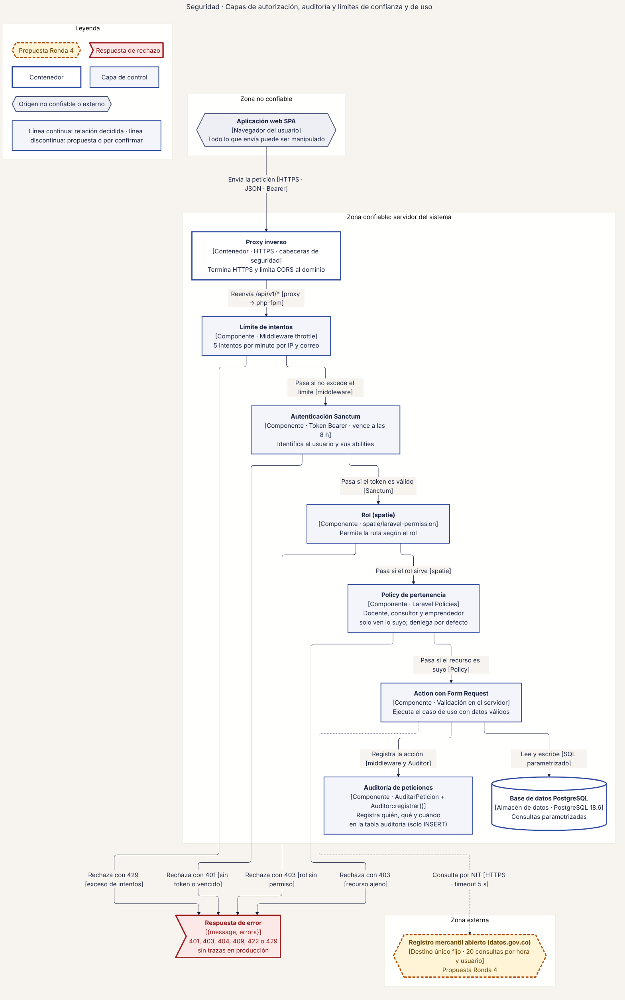
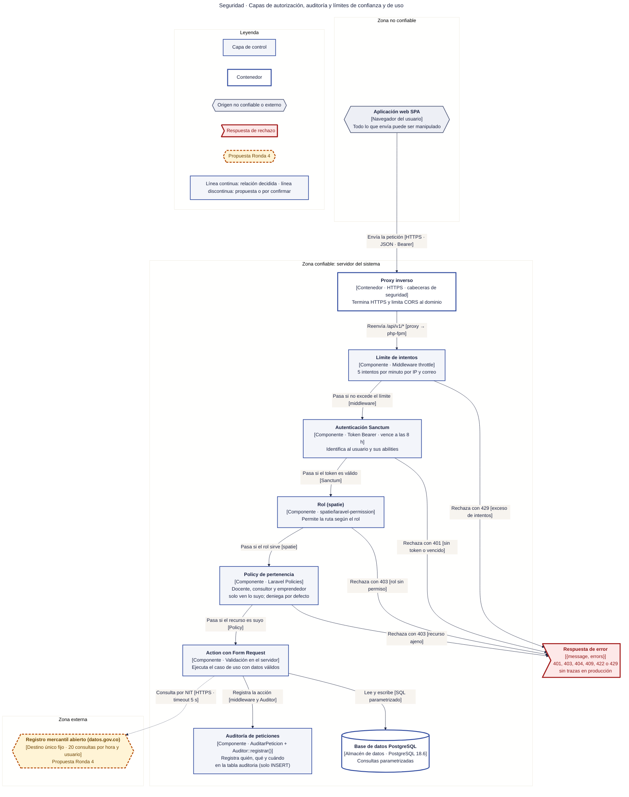

# 61 · Seguridad · Capas de autorización, auditoría y límites

**Qué responde este diagrama.** ¿Por qué capas pasa una petición y dónde se rechaza?

**A quién sirve.** S y jurado técnico (ISO 25010: Seguridad).

Descargas: [SVG](img/61_seguridad_autorizacion_limites.svg) · [PNG](img/61_seguridad_autorizacion_limites.png) · [fuente Mermaid](src/61_seguridad_autorizacion_limites.mmd)

## Leyenda de notación

Rectángulo azul claro = capa de control · rectángulo blanco = contenedor · hexágono gris = origen no confiable o externo · bandera roja = respuesta de rechazo · cilindro = almacén de datos · recuadros con título = zonas de confianza · línea discontinua = propuesta de la Ronda 4.

## Cómo leerlo y decisiones

1. El límite de 20 consultas por hora al registro y el destino único son propuesta de la Ronda 4.
2. «Límites» se interpretó como límites de confianza y de uso (la instrucción llegó cortada).

## Fuentes en el manual

- `01_trazabilidad.md` §7
- `05_arquitectura.md` §4 y §8
- `tareas/T-10.md` §5

## Preguntas y contradicciones que lo afectan

Ver `99_preguntas_abiertas_diagramas.md`: Q-D8, Q-D15.

## Resultado de la revisión

Ver la fila 61 de `90_verificacion_calidad.md` (lista de 18 puntos de `00_investigacion_metodologia.md` §6).

Fuente Mermaid (GitHub la dibuja sin instalar nada)

