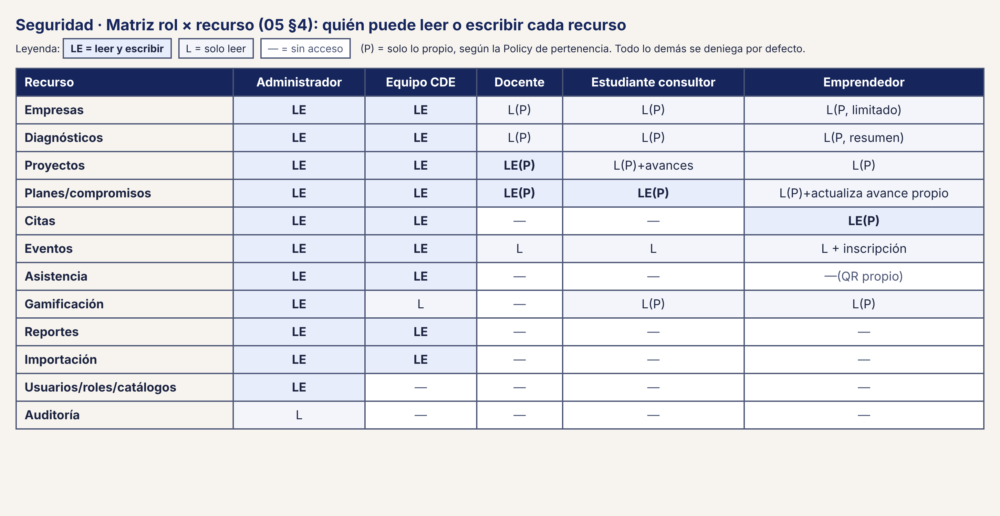

# 62 · Seguridad · Matriz rol × recurso

**Qué responde este diagrama.** ¿Qué rol puede leer o escribir cada recurso?

**A quién sirve.** S y jurado técnico.

Descargas: [PNG](img/62_seguridad_matriz_rol_recurso.png)

## Leyenda de notación

LE = leer y escribir · L = solo leer · — = sin acceso · (P) = solo lo propio, según la Policy de pertenencia · todo lo demás se deniega por defecto.

## Cómo leerlo y decisiones

1. La matriz es la fuente de verdad de la prueba `MatrizRolesTest`.

## Fuentes en el manual

- `01_trazabilidad.md` §7
- `05_arquitectura.md` §4 punto 4

## Preguntas y contradicciones que lo afectan

Ver `99_preguntas_abiertas_diagramas.md`: Q-D8.

## Resultado de la revisión

Ver la fila 62 de `90_verificacion_calidad.md` (lista de 18 puntos de `00_investigacion_metodologia.md` §6).

## Matriz en texto

| Recurso | Administrador | Equipo CDE | Docente | Estudiante consultor | Emprendedor |
|---|:-:|:-:|:-:|:-:|:-:|
| Empresas | LE | LE | L(P) | L(P) | L(P, limitado) |
| Diagnósticos | LE | LE | L(P) | L(P) | L(P, resumen) |
| Proyectos | LE | LE | LE(P) | L(P)+avances | L(P) |
| Planes/compromisos | LE | LE | LE(P) | LE(P) | L(P)+actualiza avance propio |
| Citas | LE | LE | — | — | LE(P) |
| Eventos | LE | LE | L | L | L + inscripción |
| Asistencia | LE | LE | — | — | —(QR propio) |
| Gamificación | LE | L | — | L(P) | L(P) |
| Reportes | LE | LE | — | — | — |
| Importación | LE | LE | — | — | — |
| Usuarios/roles/catálogos | LE | — | — | — | — |
| Auditoría | L | — | — | — | — |
