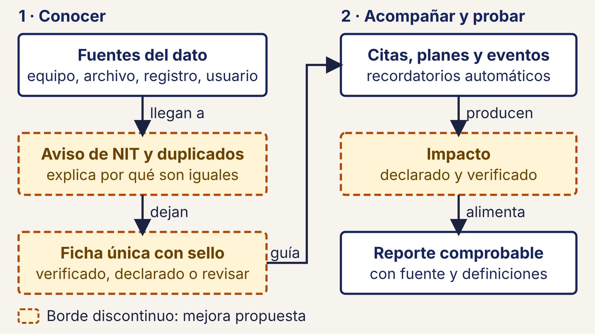

# 70 · Versión simplificada para una diapositiva del pitch

**Qué responde este diagrama.** ¿Cómo se explica en una imagen que cada dato dice de dónde viene?

**A quién sirve.** MP y quien presenta; jurados de negocio.

Descargas: [SVG](img/70_pitch_una_diapositiva.svg) · [PNG](img/70_pitch_una_diapositiva.png)

## Leyenda de notación

Caja blanca con borde azul marino = paso ya previsto en el plan · caja crema con borde naranja discontinuo = mejora propuesta · flecha = relación con un verbo · las flechas van en un solo sentido.

## Cómo leerlo y decisiones

1. 6 cajas; texto de 48 px o más en un lienzo de 1920 × 1080 px (24 pt o más en una diapositiva de 13,33 in).
2. Está dibujada a mano en SVG porque Mermaid no controla el tamaño de letra final; el SVG es la fuente.
3. Las cajas con borde discontinuo son propuestas de la Ronda 4: no deben presentarse como terminadas si no entran en la demo.

## Fuentes en el manual

- `investigacion/03_diferenciadores_nuevos.md` §1
- `investigacion/06_requerimientos_funcionales_detallados.md` §9

## Resultado de la revisión

Ver la fila 70 de `90_verificacion_calidad.md` (lista de 18 puntos de `00_investigacion_metodologia.md` §6).
